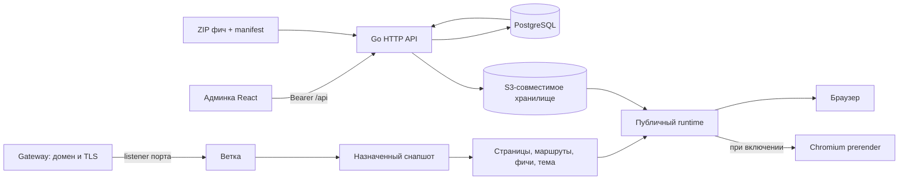
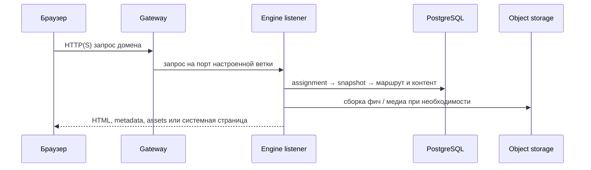

# Архитектура

Website Engine разделяет административный API, хранилище состояния, статические сборки фич и публичные listeners. Gateway завершает TLS и выбирает порт; Engine сопоставляет listener со статической веткой и её назначенным снапшотом.

## Компоненты

- **Frontend admin** — React 18 SPA под `/admin/`; формы и запросы используют общий API-клиент.
- **Go API** — маршрутизация, авторизация, валидаторы, управление снапшотами, публикация контента и публичный runtime.
- **PostgreSQL** — ветки, снапшоты, ревизии, контент, пользователи, заявки и ссылки на объекты.
- **S3** — закрытое хранилище ZIP-фич, медиа, файлов и подготовленных вариантов.
- **Статические listeners** — отдельный HTTP-порт на каждую ветку; внешние URL передаёт gateway.
- **Фичи** — готовые статические ZIP, версия и digest которых закреплены в снапшоте.

## Поток публичного запроса

При включённом пререндере Engine может получить HTML в изолированном Chromium worker. Публичный браузер затем активирует тот же runtime. Worker ограничен временем, размером результата, сетью, количеством запросов и параллелизмом.

## Авторизация

Админские маршруты используют Bearer-токены и server-side роли. Публичные запросы ограничены CORS каждой ветки; API интеграционных файлов требует отдельные service credentials. Публичный runtime не получает токенов, закрытых файлов или административных прав.
