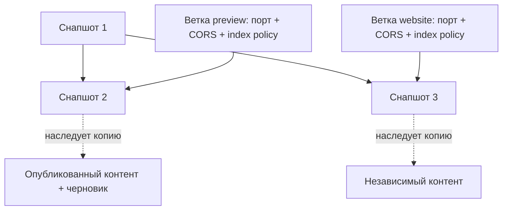

# Ветки, снапшоты и контент

Ветка и снапшот решают разные задачи. Ветка — статически описанный порт, на котором сайт обслуживается; снапшот — конкретное состояние структуры. Назначение связывает их.

## Структура снапшота

Снапшот фиксирует страницы, маршруты, размещения, точные версии сборок фич, аргументы и сопоставления входов, ER-модель, метаданные и дизайн-систему. Структурные изменения, включая модель и bindings, сохраняются новым дочерним снапшотом; родитель не редактируется.

При создании потомка состояние родителя копируется на момент операции. Структура, модель, опубликованные записи и черновики потомка меняются независимо. Копирование не назначает его ветке.

## Контент в снапшоте

Контент хранится как записи сущностей модели, а не как набор feature-specific форм. `/content` генерирует формы по модели; связи полей с потребителями фич задаются структурно в `/site`. Черновики и опубликованные записи наследуются в потомка; публикация обновляет только контент текущего снапшота и не создаёт узел дерева.

Выбор и порядок записей для конкретного размещения — редакционный контент. Несколько фич могут использовать одни и те же записи; например, каталог показывает все товары, а слайдер — выбранное упорядоченное подмножество.

Все ветки, назначенные на один снапшот, читают его опубликованный контент. Для подготовки контента без публикации используется тот же снапшот и draft revision.

## Защита дерева

Нельзя удалить назначенный снапшот и его непосредственного родителя. Разрешённый промежуточный узел удаляется с переподключением его детей к родителю; состояние детей остаётся неизменным. Назначения веток никогда не меняются как побочный эффект удаления или создания.
