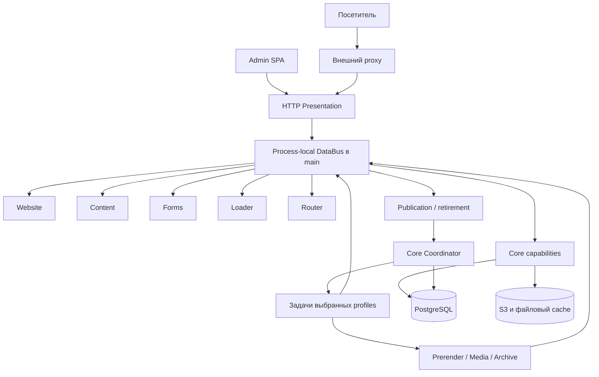
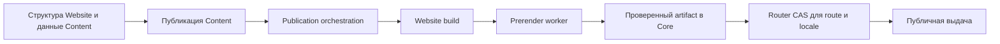

# Архитектура Website Engine

Схема показывает основные компоненты и направление продуктовых операций на
основании текущей композиции. Она не является доказательством готовности всех
сценариев. Целевые границы определяются [архитектурой Core](../spec/core/SPEC-core-architecture.md)
и [спецификацией модульной платформы](../spec/architecture/SPEC-modular-platform.md).

`main/` собирает выбранный статический profile, регистрирует компоненты и их
разрешённые операции. `pkg/contracts` содержит общие типизированные контракты;
стрелки на схеме обозначают назначение операций и зависимостей, а не гарантируют
способ каждого отдельного вызова в реализации. HTTP-клиент не выбирает operation
ID. Передача больших файлов выполняется через scoped stream capability; JSON
envelope не предназначен для file bodies. Внутренние вызовы внутри одного модуля
могут быть прямыми. Проверка соответствия межмодульных границ остаётся частью
приёмки.

Core владеет PostgreSQL, S3 и общим файловым cache. Engine records размещаются
в `engine_data.records` в namespace владельца; identity scope задаёт композиция.
Coordinator хранит долговечные workflow и задачи. DataBus является локальным
транспортом процесса и сам не предоставляет долговечность.

## Основной поток публикации

Website управляет страницами, snapshots, placements и bindings; Content —
редакционными записями и публикацией. Trusted input сборки закрепляет snapshot,
locale, Content и другие необходимые версии. Router хранит сопоставление
маршрута с artifact; назначение Router branch задаётся конфигурацией запуска.
При выводе страницы из эксплуатации отдельный retirement workflow должен
отозвать все зарегистрированные маршруты до перехода страницы в `retired`.

Текущая реализация содержит orchestration publication и retirement, но
независимость частичных отказов и повтор только неуспешных целей ещё не
подтверждены и требуют исправления. `WEB-012` и `WEB-018..022` заблокированы
компиляцией tagged integration fixtures. Детали и evidence — в
[QA report](QA_REPORT.md), открытые задачи — в [активном плане](TODO-admin-snapshots-content-files.md),
сценарии и их статусы — в [ledger](../tests/qa/website-scenarios.json).
