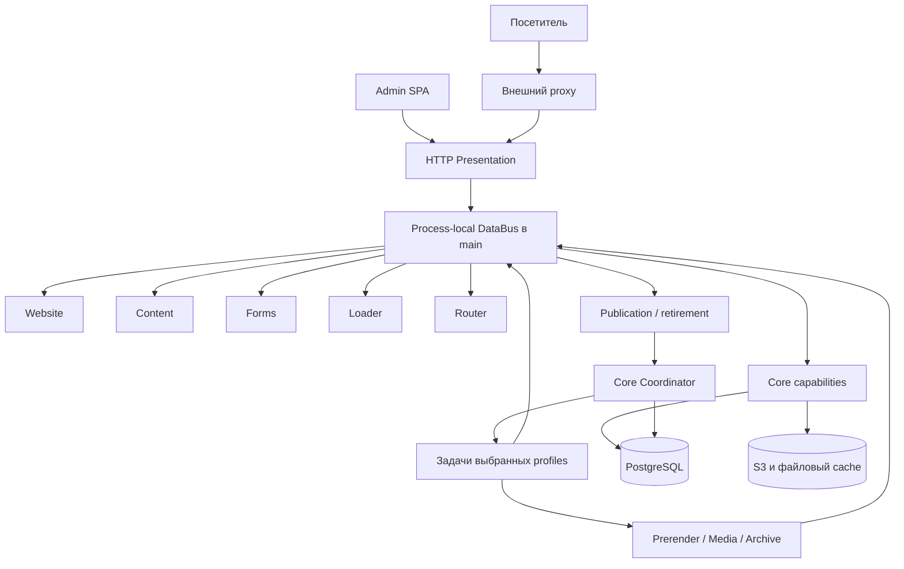
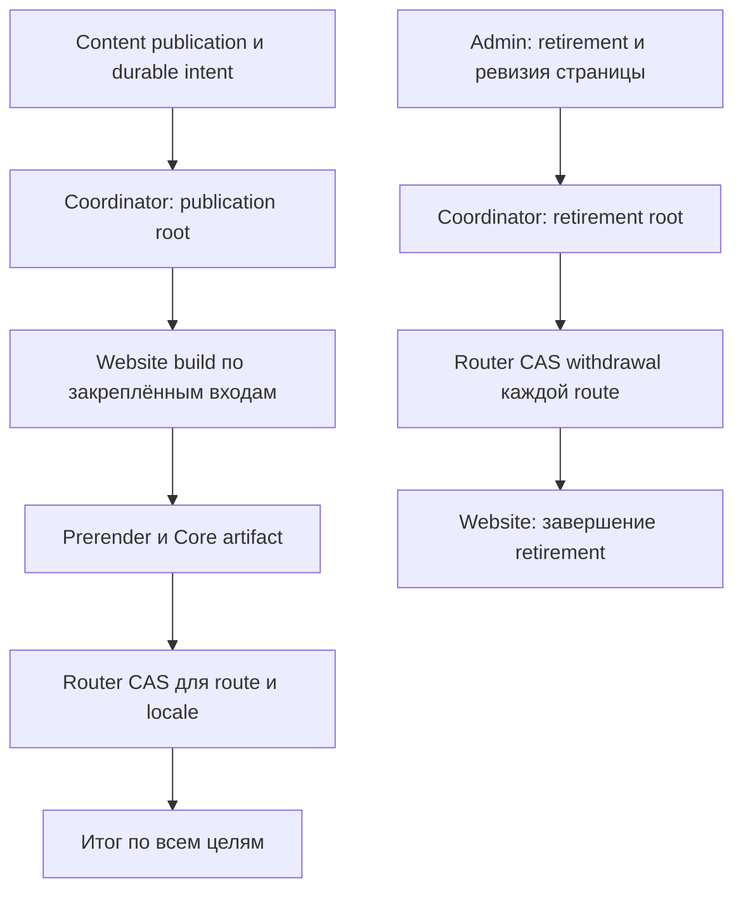

# Архитектура Website Engine

Схема показывает основные компоненты и направление продуктовых операций на
основании текущей композиции. Она не является доказательством готовности всех
сценариев. Целевые границы определяются [архитектурой Core](../spec/core/SPEC-core-architecture.md)
и [спецификацией модульной платформы](../spec/architecture/SPEC-modular-platform.md).

`main/` собирает выбранный статический profile, регистрирует компоненты и их
разрешённые операции. `pkg/contracts` содержит общие типизированные контракты;
стрелки на схеме обозначают назначение операций и зависимостей, а не гарантируют
способ каждого отдельного вызова в реализации. HTTP-клиент не выбирает operation
ID. Передача больших файлов выполняется через scoped stream capability; JSON
envelope не предназначен для file bodies. Внутренние вызовы внутри одного модуля
могут быть прямыми. Проверка соответствия межмодульных границ остаётся частью
приёмки.

Core владеет PostgreSQL, S3 и общим файловым cache. Engine records размещаются
в `engine_data.records` в namespace владельца; identity scope задаёт композиция.
Coordinator хранит долговечные workflow и задачи. DataBus является локальным
транспортом процесса и сам не предоставляет долговечность.

## Публикация и вывод страницы из эксплуатации

Website владеет страницами, snapshots и структурными bindings. Content владеет
редакционными записями и публикациями, Router — связью адреса с artifact.
Router слушает один настроенный публичный адрес и использует общий реестр
маршрутов. Новая установка использует системную область хранения. Checkout
не выполняет перенос устаревших Router scope и не удаляет записи при старте.

Схема отражает порядок задач. Core Coordinator хранит зависимости между
эмиссиями. Задачи publication и retirement обращаются к Website и Router
через типизированные операции DataBus, зарегистрированные статическим
профилем. Отдельный внутренний DTO передаёт locale revision для Router CAS.
Обработчики сохраняют результат каждой цели. Ожидаемый отказ цели оставляет
остальные задачи активными. Повтор запускает отдельную durable attempt для
незавершённых целей, сохраняя исходный run или job ID.
Retirement переводит страницу в `retired` после успешного удаления всех
зарегистрированных маршрутов.

Production prerender строит HTML из конфигурации snapshot. Подключение
закреплённых feature builds, Content values, media derivatives и browser
hydration к этому потоку остаётся открытым. Поддержка `schema_kind: arguments |
dataInputs` действует на входе в подготовку media.

## Оценка по имеющимся реестрам

В таблице — доля записей со статусом `pass` в указанном реестре, а не процент
готовности всего модуля. Статус записи не означает, что сценарий повторно
исполнен на текущем checkout; уровень и ограничения проверки нужно сверять с
реестром и QA-отчётом. Для полной оценки нужны исполняемые сценарии на текущем
коде и применимая изолированная приёмка.

| Часть | Доля `pass` в указанном реестре | Граница оценки |
| --- | --- | --- |
| Website | 29/29 — 100% | [Website](../tests/qa/website-scenarios.json) — зарегистрированные проверки. Browser lifecycle и реальные feature placements остаются в расширенной приёмке. |
| Content | 4/5 — 80% | [Content](../tests/qa/content-scenarios.json): четыре contract-сценария и один заблокированный E2E; полная приёмка Content не подтверждена. |
| Forms | 4/5 — 80% | [Forms](../tests/qa/forms-scenarios.json): четыре contract-сценария и один заблокированный E2E; это не оценка всех workflows Forms. |
| Loader | 4/5 — 80% | [Loader](../tests/qa/loader-scenarios.json): четыре contract-сценария и один заблокированный E2E; это не оценка всех workflows Loader. |
| Router cache | 5/6 — 83,3% | [Router cache](../tests/qa/cache-router-scenarios.json): ограниченный набор проверок cache, один E2E blocked; не оценка Router целиком. |
| Core (owner-scoped результат задачи) | 1/1 — 100% | [Core](../tests/qa/core-scenarios.json): только `CORE-001`, owner-scoped доступ к результату task. Это не означает 100% готовности Core или Coordinator. |
| Observability | 10/10 — 100% | [OBS](../tests/qa/obs-scenarios.json): результаты отдельного прогона с OpenObserve; повтор на текущей ревизии открыт. |
| Core cache | 11/11 — 100% | [Core cache](../tests/qa/core-cache-scenarios.json): проверены зарегистрированные сценарии cache и concurrency. |
| Workers | Не определена | Website integration подтвердил media и prerender в Docker/Linux. Общего набора приёмки всех workers нет. |
| Admin и HTTP Presentation | Не определена | Имеются отдельные unit и browser-проверки, но полного согласованного набора для расчёта готовности нет. |
| Композиция и полная система | Не определена | Требуются актуальные сквозные проверки всех profiles и интеграции; исторический E2E не подтверждает текущий checkout. |

Runner объединяет 84 сценария. Отдельные 16 записей Coordinator ledger пока
не входят в эту сводку. Актуальные результаты выполнения и ограничения
приведены в [QA-отчёте](QA_REPORT.md).
