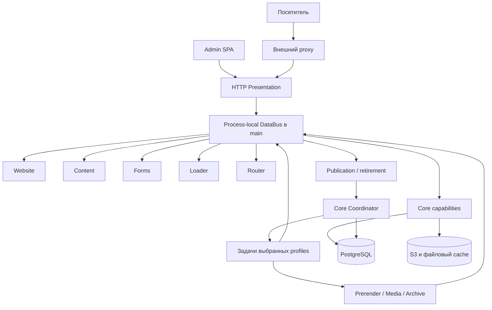
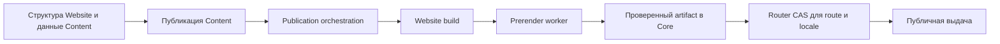

# Архитектура Website Engine

Схема показывает основные компоненты и направление продуктовых операций на
основании текущей композиции. Она не является доказательством готовности всех
сценариев. Целевые границы определяются [архитектурой Core](../spec/core/SPEC-core-architecture.md)
и [спецификацией модульной платформы](../spec/architecture/SPEC-modular-platform.md).

`main/` собирает выбранный статический profile, регистрирует компоненты и их
разрешённые операции. `pkg/contracts` содержит общие типизированные контракты;
стрелки на схеме обозначают назначение операций и зависимостей, а не гарантируют
способ каждого отдельного вызова в реализации. HTTP-клиент не выбирает operation
ID. Передача больших файлов выполняется через scoped stream capability; JSON
envelope не предназначен для file bodies. Внутренние вызовы внутри одного модуля
могут быть прямыми. Проверка соответствия межмодульных границ остаётся частью
приёмки.

Core владеет PostgreSQL, S3 и общим файловым cache. Engine records размещаются
в `engine_data.records` в namespace владельца; identity scope задаёт композиция.
Coordinator хранит долговечные workflow и задачи. DataBus является локальным
транспортом процесса и сам не предоставляет долговечность.

## Основной поток публикации

Website управляет страницами, snapshots, placements и bindings; Content —
редакционными записями и публикацией. Trusted input сборки закрепляет snapshot,
locale, Content и другие необходимые версии. Router хранит сопоставление
маршрута с artifact. По уточнению владельца системы используется один Router
listener и единый реестр маршрутов. В текущем коде, YAML и спецификации Router
ещё встречается идентификатор branch. Эти места требуют отдельной сверки с
фактической конфигурацией и форматом сохранённых маршрутов.
При выводе страницы из эксплуатации отдельный retirement workflow должен
отозвать все зарегистрированные маршруты до перехода страницы в `retired`.

Текущая реализация содержит orchestration publication и retirement, но
независимость частичных отказов и повтор только неуспешных целей ещё не
подтверждены и требуют исправления. `WEB-012` и `WEB-018..022` заблокированы
компиляцией tagged integration fixtures. Детали и evidence — в
[QA report](QA_REPORT.md), открытые задачи — в [активном плане](TODO-admin-snapshots-content-files.md),
сценарии и их статусы — в [ledger](../tests/qa/website-scenarios.json).

## Оценка по имеющимся реестрам

В таблице — доля записей со статусом `pass` в указанном реестре, а не процент
готовности всего модуля. Статус записи не означает, что сценарий повторно
исполнен на текущем checkout; уровень и ограничения проверки нужно сверять с
реестром и QA-отчётом. Для полной оценки нужны исполняемые сценарии на текущем
коде и применимая изолированная приёмка.

| Часть | Доля `pass` в указанном реестре | Граница оценки |
| --- | --- | --- |
| Website | 23/29 — 79,3% | [Website](../tests/qa/website-scenarios.json): 6 integration-сценариев blocked, включая media, prerender, publication и retirement. |
| Content | 4/5 — 80% | [Content](../tests/qa/content-scenarios.json): четыре contract-сценария и один заблокированный E2E; полная приёмка Content не подтверждена. |
| Forms | 4/5 — 80% | [Forms](../tests/qa/forms-scenarios.json): четыре contract-сценария и один заблокированный E2E; это не оценка всех workflows Forms. |
| Loader | 4/5 — 80% | [Loader](../tests/qa/loader-scenarios.json): четыре contract-сценария и один заблокированный E2E; это не оценка всех workflows Loader. |
| Router cache | 5/6 — 83,3% | [Router cache](../tests/qa/cache-router-scenarios.json): ограниченный набор проверок cache, один E2E blocked; не оценка Router целиком. |
| Core | 1/1 — 100% | [Core](../tests/qa/core-scenarios.json): только `CORE-001`, owner-scoped доступ к результату task. Это не означает 100% готовности Core или Coordinator. |
| Workers | Не определена | Общего подтверждённого набора для всех workers нет; Website integration-сценарии media и prerender blocked. |
| Admin и HTTP Presentation | Не определена | Имеются отдельные unit и browser-проверки, но полного согласованного набора для расчёта готовности нет. |
| Композиция и полная система | Не определена | Требуются актуальные сквозные проверки всех profiles и интеграции; исторический E2E не подтверждает текущий checkout. |
