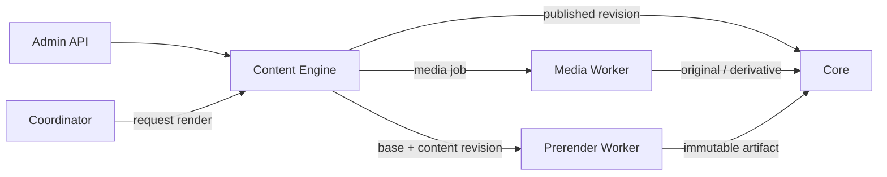

# Content Engine: целевая спецификация

Статус: проект; границы модулей и приоритет решений — [SPEC-coordinator-platform.md](SPEC-coordinator-platform.md). Исторические документы моделей и backend bindings не подтверждают реализацию новой архитектуры.

## Данные и публикация

Content владеет типизированными моделями, записями, черновиками, опубликованными ревизиями, локалями и описаниями источников данных. Модели и payload версионируются в scoped `core.module_data`, файлы доступны только через Core. Идентификаторы создаются сервером. Модель описывает поля, типы, ограничения, переводимость, cardinality и ссылки на Core files. Изменение схемы не должно молча уничтожать данные; несовместимое изменение требует явной миграции или отклоняется.

Локализуемое поле содержит значения по объявленным locale; непереводимое имеет одно значение. Допустимые locale, default locale и порядок fallback задаются явно. Проверка предотвращает циклический fallback; отсутствие значения трактуется по опубликованной политике. Локализуемые alt и подписи медиа принадлежат Content, bytes — Core.

Публикация создаёт зафиксированную ревизию, пригодную для воспроизводимого prerender. Конфигурация связи с сайтом и маршрутом задаётся в YAML Coordinator при старте. При изменении опубликованного контента Coordinator инициирует асинхронный prerender с актуальной основой сайта; устаревшая пара входов не публикуется. Вопросы конкуренции и атомарного переключения определены общей спецификацией.

## Маршруты и внешние endpoints

Content может описывать параметры пути и query, правила их проверки и mapping в публичную конфигурацию запроса браузера. Endpoint содержит адрес/маршрут и разрешённые параметры, необходимые frontend feature. Браузер вызывает внешний backend напрямую; Content не проксирует запросы и не хранит в публичной конфигурации credentials. Для внешних origins необходима соответствующая CORS-политика сервиса.

Поддерживаются именованные параметры и ограничения Go RE2, компиляция при публикации, лимиты размера и числа выражений и выявление конфликтов. Точный синтаксис шаблонов и семантику нормализации ещё нужно определить. Пользовательские выражения не должны создавать открытые redirect targets либо произвольные backend origins.

Configuration API находится на общем admin listener; публичный Content Runtime handler подключается отдельно профилем и вызывается Router Presentation по зарегистрированному маршруту. Router Engine не вызывает Content. Runtime возвращает лишь разрешённые опубликованные данные и проверяет Core access при чтении файлов.

## Медиа и prerender

Content хранит исходный file ID и может поставить Media Worker задачу с разрешённым профилем обработки. Исходник сохраняется; результат — новый Core file с унаследованными группами. Версия профиля и hash исходника входят в fingerprint. Если для публикуемого контента требуется обработанное изображение, публикация ожидает успешного завершения Media Worker и проверки результата. При ошибке новый артефакт не публикуется; текущая публичная версия остаётся доступной, ошибка видна оператору и может быть повторена. Оригинал не подставляется автоматически вместо требуемого производного файла.

## Приёмка

Проверить модель и версии, конкуренцию draft/publish, fallback локали, несовместимые изменения схемы, route validation и конфликты, отсутствие проксирования/секретов, media preset и права, воспроизводимость двух входных ревизий, отказ и повтор workers, удаление оригинала и ревокацию доступа. Результаты фиксируются для изолированной среды; формулировка спеки не является свидетельством тестирования.
