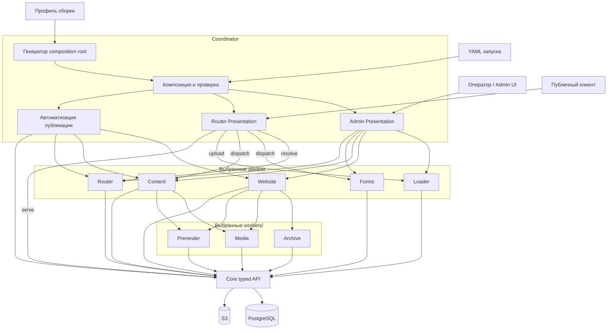
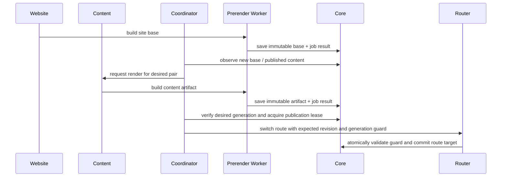

# Coordinator и модульная платформа: целевая архитектура

Статус: целевая архитектура; реализация и пробелы отражены отдельно в [SPEC-coordinator-implementation.md](SPEC-coordinator-implementation.md), это описание само по себе не является свидетельством приёмки. Этот документ имеет приоритет для `dev_v2` над прежними описаниями состава сборки, взаимодействия движков, воркеров, маршрутизации и старых ABI. Существующие legacy-спецификации сохраняются как исторический контекст. Core и `module_data` определены в [SPEC-core-v2.md](SPEC-core-v2.md) и [SPEC-module-data.md](SPEC-module-data.md); специализированные детали Website, Router и artifact читаются с учётом этого документа. Решения и открытые вопросы собраны в [SPEC-architecture-review.md](SPEC-architecture-review.md).

## Принципы

- Coordinator — composition root и владелец межмодульной автоматизации. Профиль при сборке выбирает компоненты; YAML при запуске настраивает включённые возможности и связи. Динамическая загрузка кода не требуется.
- Core обязателен и предоставляет общий типизированный интерфейс работы с файлами, идентичностями, доступом, наборами и метаданными, включая ограниченные capabilities для модулей. PostgreSQL, S3 и Atlas принадлежат Core; двигатели и воркеры не получают SQL/DSN/S3 clients.
- Движки независимы: не импортируют друг друга, не вызывают API друг друга и не читают чужой namespace. Coordinator и Presentation могут вызывать несколько движков по их публичным контрактам. Идентичность модуля назначает композиция.
- `workers/` содержит независимые обработчики, не Worker Engine. Движки могут ставить им задания через явно подключённый типизированный контракт; воркеры не вызывают движки и работают с файлами и состоянием через Core.
- Каждый HTTP API — выбираемая часть Presentation. Административные API используют один admin listener; Router Presentation использует отдельный публичный listener. TLS/proxy и адреса задаются конфигурацией.
- Core имеет одну сущность пользователя, прямые уровни доступа к статичным группам `0/1/2`, отдельное право управления пользователями, без ролей и владельцев. Уровень через любую группу достаточен. Файлы неизменяемы и требуют хотя бы одной группы; наборы не дают прав. Публичная выдача требует явного маршрута и проверки Core.



## Профиль и жизненный цикл сборки

Отдельный файл профиля перечисляет конкретные engines, workers, presentation API и автоматизации. Формат ниже иллюстративен и не объявляет готовую команду или существующие конфигурационные поля:

```yaml
profile: custom
engines: [loader, website, content, forms, router]
workers: [archive, media, prerender]
apis:
  admin: [files, website, content, forms, router]
  public: [router, form-submit, form-upload, content-runtime]
automation: [site-publication]
```

Команда сборки валидирует профиль по статическому registry компонентов, строит граф зависимостей и генерирует Go source с imports только выбранных compile-time модулей, регистрацией descriptors движков и canonical build plan. Генерация детерминирована. Runtime composition отдельно проверяет наличие выбранных component factories и отказывает до запуска любых компонентов, если фабрики или зависимости отсутствуют. Профиль не принимает import paths и не загружает код динамически. Текущий `profilegen` реализует валидацию, imports, descriptors и plan, но не создаёт отсутствующие runtime factories; `minimal` запускает текущий набор Core/Coordinator/Loader/File API, а `full` пока является только compile-профилем и не может быть запущен до реализации фабрик.

Core входит всегда. Взаимосвязи проверяются по capabilities, а не по эвристическому имени: File API требует Loader; публичная отправка Forms — Forms, Router и соответствующий presentation handler; multipart forms дополнительно требует Loader и upload handler; site-publication требует Router, Website, Content, Prerender и необходимых presentation/automation contracts. Оптимизация, архивный импорт и отдельные API могут отсутствовать, если ни одна включённая конфигурация их не требует. Профиль может включить engine без его admin API. Примеры `full` и `minimal` могут поставляться как обычные профили без особых семантических исключений.

При старте YAML loader проверяет обязательные параметры, UUID связок, явный `auto_publish`, уникальность route bindings и числовые пределы. До запуска Core конфигурация также сверяется с build plan: bindings требуют `automation.site-publication`, Website, Content, Router и Prerender; включённая automation требует хотя бы один binding. Runtime composition сверяет выбранный build plan с реальными фабриками и порядком зависимостей. Неизвестные поля и отсутствующие обязательные значения приводят к ошибке до открытия listener. Связи сайта, контента и маршрута задаются в YAML и не меняются runtime API. Секреты передаются через окружение или секретные файлы, не в profile/manifest. Этот проход валидирует минимальный Coordinator/File API runtime; полный cross-engine config validation остаётся незавершённым вместе с отсутствующими фабриками.

Для масштабирования каждый экземпляр может содержать Coordinator и выбранные обработчики. Жизненный цикл: validation → создание Core и ограниченных capabilities → создание выбранных engines/workers → регистрация API и задач → readiness → graceful shutdown с прекращением новых задач. Реализованные lifecycle contracts запускают компоненты в dependency order, откатывают частичный startup в обратном порядке, следят за fatal errors и ограничивают graceful shutdown конфигурационным timeout; factory/start/readiness/stop panic превращаются в безопасный отказ компонента, а shutdown продолжает останавливать предыдущие зависимости. Компоненты обязаны уважать переданный context; Go не может принудительно остановить некооперативный Stop или handler. Публичная готовность не объявляется до проверки обязательных зависимостей.

WorkerPool активируется только после успешной готовности всех выбранных компонентов. Административный endpoint заданий подключается только компонентом `admin.coordinator`; для него явно задаётся статическая Core-группа. Уровень 1 разрешает читать ограниченные сводки заданий, уровень 2 — повторно запускать только задания в состоянии `failed`. Проверка учётных данных и актуального прямого доступа к группе выполняется Core на каждый HTTP-запрос; административное право управления пользователями не даёт обхода групповой проверки. UI может скрыть недоступное действие, но сервер остаётся источником авторизации.

Экземпляр, у которого непубличная конфигурация системы или compile-time профиль отличаются от работающих экземпляров, не должен запускаться. Core хранит non-secret fingerprint и epoch; registration сериализуется транзакцией, а fingerprint change разрешается только после истечения или явного release всех instance leases. Fingerprint включает канонический список выбранных component IDs; разный порядок одинакового профиля не меняет значение. Старые epoch jobs отменяются при переходе. Для изменения YAML или состава сборки оператор останавливает все экземпляры, обновляет одинаковую конфигурацию/версию на всех экземплярах и запускает их снова. Fingerprint не раскрывает secret values или env-variable names. DB проверка и epoch не заменяют обязательную конфигурационную процедуру оператора.

Admin UI использует общий UI provider и имеет встроенный минимальный резервный интерфейс, работающий при недоступности provider. В нём доступны вход и восстановление настройки provider выбором ранее загруженной совместимой версии; загрузка нового ZIP и другие административные возможности не требуются. Выбор доступен пользователю с уровнем 2 в выделенной группе provider, заданной конфигурацией. Авторизация проходит через обычные контракты Core.

После проверки совместимости выбор версии provider сразу переключает админку и отдельно запускает автоматическое обновление затронутых опубликованных сайтов. Для каждого затронутого snapshot создаётся дочерний snapshot с новой точной версией provider; Website и Content создают новый artifact, затем соответствующие routes переключаются. Если исходный snapshot используется несколькими маршрутами, они используют один дочерний snapshot, а каждый route переключается отдельной атомарной операцией. Это отдельное обновление выполняется и при выключенной автопубликации маршрута. Ошибка одного сайта не откатывает успешно обновлённые: этот сайт продолжает работать с прежним artifact, оператор видит ошибку и вручную запускает повтор. Если provider несовместим с опубликованной фичей, сайт не переключается и оператор получает причину. Срок переключения определяется завершением сборки; до этого сайт продолжает отдавать прежнюю публикацию.

Для обычной публикации Coordinator/Core реализуют неизменяемый снимок route bindings из YAML: trigger передаёт route ID, неизменяемые revisions и provider version, а site/content IDs и auto-publish policy берутся из конфигурации. Внешний trigger не задаёт ID base artifact: Coordinator всегда запрашивает базовую сборку у Website с configured site ID и snapshot. Обычная автопубликация отклоняет выключенную связь; отдельный внутренний rebuild может обходить auto-publish только для уже настроенного route и не должен напрямую открываться HTTP без авторизации. Handler сверяет route/site/content tuple с теми же bindings и отбрасывает незарегистрированное сочетание до внешних эффектов. Тип publication job зарезервирован: общий enqueue его отклоняет, а Core принимает его только через транзакционную команду с совпадающим route ID и самостоятельно добавляет generation.

Coordinator/Core атомарно проверяют desired generation, job lease/fencing и готовность artifact при переключении одного route. При смене desired input или ручной замене target Core отменяет queued/running jobs предыдущих поколений и освобождает их lease; работающий builder увидит отмену на следующем context/lease check, а даже опоздавшая активация не пройдёт fencing. Повторное планирование тех же входов после ручной замены получает новое generation. PostgreSQL invalidations обеспечивают router cache reload, включая wildcard после reconnect/overflow. Слой Coordinator и ограниченный API просмотра/повтора заданий доступны в текущей сборке при выборе `admin.coordinator`; это не завершает сквозной workflow. Website/Content publish-trigger wiring, production handlers, Router runtime, provider compatibility и multi-site child-snapshot flow пока не реализованы; до этого утверждение о полной продуктовой автоматизации не считается выполненным.

## Движки и внешние входы

**Loader.** Единый движок upload sessions, parts, checksum, idempotency, resume и cleanup. Используется Admin File API и публичной загрузкой форм. Состояние хранится через scoped Core API; bytes — через Core staging и file API. См. [SPEC-module-data.md](SPEC-module-data.md). Форма не вызывает Loader; последовательность координирует Presentation.

**Website.** Управляет каталогом feature ZIP, снапшотами, зависимостями manifest, структурой сайта и первой стадией prerender. ZIP загружается через File API/Loader; Website получает `source_file_id`, создаёт FileSet версии по настроенной управляющей группе и поручает распаковку Archive Worker. Website проверяет результат и удаляет ZIP после успешной проверки; версия становится готовой после подтверждения очистки. Файлы наследуют группы исходника; FileSet не выдаёт прав. Точные feature versions закрепляются в snapshot. Фичи могут экспортировать design tokens и UI через manifest. Новый ABI включает `render`, `hydrate`, `update`, `dispose`; старые ABI не поддерживаются, ZIP Vitasil адаптируются. Общий UI provider используется также Admin UI; точный контракт и порядок загрузки ещё необходимо определить.

**Content.** Владеет моделями, записями, публикацией, локализациями, route-моделями и внешними endpoint-конфигурациями. Поля модели типизированы, переводы задаются по locale; список locale, default и fallback настраиваются явно. Draft и опубликованная ревизия разделены; snapshot/связь с сайтом определяется общей YAML-конфигурацией, а входы render фиксируются неизменяемой ревизией. Модель может содержать публичный адрес backend и правила передачи параметров маршрута/query в браузерный запрос: браузер вызывает внешний backend напрямую, Content не проксирует его. Секреты в frontend config не попадают. Маршруты поддерживают именованные параметры с ограничениями Go RE2; шаблоны компилируются до публикации с лимитами и выявлением конфликтов, точный синтаксис предстоит зафиксировать. Картинки ссылаются на Core file IDs, локализованные alt/caption хранятся вместе с контентом; Content запрашивает Media Worker по разрешённому preset. Исходник сохраняется.

**Forms.** Владеет схемами форм, их опубликованными ревизиями, сессиями отправки и индексом результатов. Настройка формы выполняется отдельным admin API; публичные запросы проходят Router Presentation. Схема допускает текст, числа, даты, выбор, структурированные значения и файлы с явно заданными типами и лимитами. Аудио/видео — файлы, включая большие загрузки частями с resume через тот же Loader. Форма выбирает одну или несколько статично настроенных Core access groups. Ответ и вложения хранятся через Core; доступ уровня 1 через любую группу даёт чтение, уровня 2 — управление и удаление. Администратор может отдельно настроить публичный маршрут Router. У Core нет понятия владельца группы.

Если форма опубликована через Router, ответ может отправить любой посетитель без авторизации. Чтение результатов не становится публичным: его разрешает Core согласно группам ответа. Отдельный публичный маршрут может быть настроен для выдачи результата.

Для публичной отправки Presentation создаёт сессию формы через Forms, создаёт и ведёт загрузочные сессии через Loader, затем передаёт результаты в Forms. Связь между form session, upload session и file ID должна быть защищена ограниченным capability/token, проверяемым сервером и ограниченным конкретной сессией, операцией и сроком; точный транспорт и срок конфигурируются. Нельзя прикреплять произвольный чужой file ID. Формат ответа предлагается как JSON Core file плюс отдельные Core files вложений; module_data хранит состояние и индекс. Проверки типа/размера, авторизации, idempotency и cleanup обязательны. Публичный маршрут сам по себе не открывает ответы для чтения.

**Router.** Владеет конфигурацией маршрутов, валидирует конфликты и разрешает запрос в типизированный результат: file, static artifact или непрозрачный зарегистрированный handler с проверенными параметрами. Router Engine не зависит от других движков. Router Presentation на публичном порту вызывает Router для matching, затем сама вызывает выбранный engine presentation contract или Core. Допустимые handler IDs регистрирует Coordinator согласно профилю; неизвестный/невключённый handler нельзя активировать. Админское API Router доступно на общем admin listener. Настройки хранятся в Core; локальный cache обновляется через PostgreSQL invalidation, при невозможности проверить актуальность запрос закрывается. Автопубликация обновляет настройки через Router contract, отдельные движки его не вызывают.

## Воркеры

Все workers получают ограниченную задачу и capability Core от Coordinator. Они не принимают произвольные SQL, команды, пути или полномочия и не вызывают engines. Реализованные Core-owned таблицы и typed API обеспечивают durable enqueue, idempotency, atomic claim, attempts, database-clock lease, fencing, completion/failure, safe error codes и ручной internal retry. JSON payload и result должны быть UTF-8 объектами; невалидное кодирование отклоняется до сериализации в PostgreSQL JSONB. Coordinator строит один неизменяемый catalog только из выбранных workers: для каждого выбранного worker требуется один provider, невыбранные providers и повторяющиеся типы отклоняются, а зарезервированный publication handler допустим только при выбранной automation. Coordinator даёт Admin API узкую system-scoped capability для списка safe summaries и ручного retry; список в Core сверяет активные owner/epoch/lease в одной транзакции. Capability не читает payload/result и сама не авторизует HTTP-пользователя; Core предоставляет отдельную минимальную проверку текущего прямого доступа к группе, без user-management или file/storage операций. HTTP adapter обязан применить согласованное разрешение до вызова JobControl. WorkerPool ограничивает параллелизм и task timeout, обновляет lease, отменяет sibling workers при фатальной ошибке хранения, проверяет UTF-8, форму и размер результата и требует от handlers кооперативной отмены. Ошибка durable storage при обновлении lease делает пул нездоровым; потеря конкретной job lease считается ожидаемой сменой владельца, а потеря instance lease — фатальной. Runtime пока не регистрирует production handlers Archive/Media/Prerender; OS isolation and resource limits для тяжёлого исполнения остаются обязанностью соответствующих worker modules.

| Worker | Вход | Результат и ограничения |
|---|---|---|
| Archive | Core file ID ZIP, target set, ограничения | Проверенные извлечённые Core files; защита от traversal, symlink, дубликатов, zip bombs и чрезмерного времени/объёма. Исходник удаляется только после успешной проверки и безопасной фиксации. |
| Media | file ID, allowlisted preset/version | FFmpeg и безопасные обработчики изображений создают производные неизменяемые Core files; исходник сохраняется, группы наследуются; лимиты процесса, сетевых протоколов и размеров заданы явно. |
| Prerender | версия общего render plan и зафиксированные file IDs/revisions | Изолированный Chromium/runtime создаёт основу сайта либо готовый артефакт с контентом. Сетевые доступы ограничены; секреты недоступны коду фич. |

Возможные будущие workers: probe медиаметаданных, антивирусная проверка, OCR/транскрибация, экспорт и импорт, sitemap и проверка ссылок. Они не обязательны в первой версии. Cleanup загрузок остаётся ответственностью Loader/Core; его можно вынести в worker только при сохранении контракта и защиты от удаления чужих объектов.

Для каждого задания фиксируются стабильный ID, тип/version, fingerprint, ожидаемые входные ревизии, состояние, attempts, lease expiry и fencing token, результат или безопасная ошибка. Composition строит единый неизменяемый catalog из handler-ов выбранных workers и создаёт один WorkerPool с общим лимитом concurrency. Движок получает Coordinator capability только на своё подмножество типов этого catalog, поэтому нельзя поставить задачу без скомпилированного обработчика или чужого engine. Capability сама задаёт system/instance/epoch и возвращает только receipt. Payload содержит ссылки на данные, не секреты. Атомарный claim обеспечивает одного актуального исполнителя; истёкшая lease может быть перехвачена, а устаревший fencing token не вправе фиксировать результат. Сторонние эффекты имеют идемпотентные ключи и reconciliation; это модель at-least-once, а не обещание физически единственного запуска процесса. Таймауты, ресурсы, повторы, отмена и уборка ограничены конфигурацией. Воркер не сообщает готовность до durable фиксации результата.

## Двухэтапный prerender и автоматическая публикация

1. Website фиксирует snapshot и запускает Prerender Worker. Результат — неизменяемая основа сайта с версионированным контрактом входа контента.
2. Content фиксирует опубликованную ревизию и запускает Prerender Worker с ID основы и данными ревизии. Результат — immutable [static-site-artifact/v1](SPEC-static-site-artifact.md).
3. Coordinator находит связку из YAML и, если включена автопубликация, назначает актуальный результат Router. Изменение сайта запускает обе стадии; изменение контента — вторую стадию с актуальной основой.
4. Желаемая пара `(site_base_revision, content_revision)` хранится с поколением публикации. Более старая задача не должна заменять результат новой пары; текущий публичный маршрут остаётся активным до успешного переключения.

Если для публикации нужны обработанные изображения, Coordinator ожидает успешного результата Media Worker и его проверки. Ошибка обработки оставляет текущую публичную версию активной; автоматическая подмена требуемого derivative оригиналом не допускается.

Если основа сайта готова, но стадия применения контента завершилась ошибкой, Router продолжает выдавать действующую публикацию. Задание повторяется в пределах явно настроенной политики повторов; ошибка и исчерпание попыток доступны оператору.

После исчерпания настроенных попыток автоматический повтор останавливается; оператор запускает новую попытку вручную. До успешного переключения маршрут сохраняет текущий опубликованный artifact.



Последний шаг реализован как узкий Core transaction API: desired generation, instance epoch/lease, job owner/fencing, ready Core file и route target сверяются и изменяются вместе для одного маршрута. Устаревшая попытка или generation не меняет target; повтор committed activation возвращает текущее состояние. Старые artifacts не удаляются переключением. Эта гарантия относится к одному route; атомарная публикация нескольких routes не предоставляется. Сквозная автопубликация всё ещё требует trigger wiring от Website/Content и рабочего Prerender handler.

## Приёмка

- Сгенерировать несколько пользовательских профилей; подтвердить отсутствие невыбранных импортов/модулей, детерминированность генерации и ошибки несогласованных зависимостей/YAML.
- Проверить независимость engines, worker→engine вызовы, namespace isolation и запрет прямого SQL/S3.
- Проверить маршрутизацию Presentation, выключенные handlers, публичные формы и контент, актуальность кеша и отказ при ошибке проверки.
- Проверить многократный upload частей, resume, idempotency, привязку сессии к форме, недопустимый file ID, полномочия групп 0/1/2 и окончательное удаление.
- Проверить ABI v2, ZIP лимиты, конфликт версий, сохранение originals и права на derivatives; браузерный prerender с реальными фичами в изолированной среде.
- На нескольких экземплярах проверить конкурирующий claim, истечение lease, stale fencing, падение на каждом шаге, повторы с неопределённым результатом, актуальность пар сайта/контента и атомарное переключение Router.
- Сохранить результаты проверок, ограничения и точные disposable ресурсы в QA. Эта спецификация не является доказательством прохождения проверок.

## Открытые вопросы

- Какой точный синтаксис используют именованные параметры и ограничения Go RE2, и какие модели Content поддерживают динамические параметры?
- Как версионировать и доставлять общий UI provider для Admin UI, сохраняя независимые CSS-области админки и публичного сайта?
