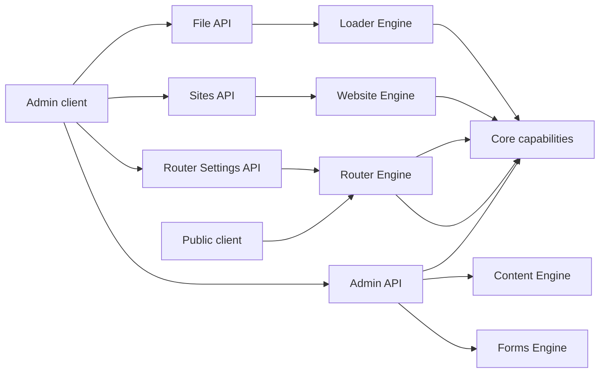

# Engine and Presentation API contracts

> **dev_v2:** Coordinator, independent workers, and separate admin/public listeners supersede conflicting composition descriptions below. Router v1 remains file/artifact-only and does not dispatch public handlers. See [SPEC-coordinator-platform.md](SPEC-coordinator-platform.md) for composition and [SPEC-router-engine.md](SPEC-router-engine.md) for the Router contract.

Status: agreed target boundaries; the module contracts are being scaffolded. This document defines ownership and dependency direction, not a claim that all endpoint behavior is implemented. Engine-specific domain rules remain in [SPEC-website-engine.md](SPEC-website-engine.md), [SPEC-router-engine.md](SPEC-router-engine.md), [SPEC-core-v2.md](SPEC-core-v2.md), and [SPEC-module-data.md](SPEC-module-data.md).

## Module map

| Module | Owns | Core access |
| --- | --- | --- |
| `core` | Identities, credentials, direct group assignments, immutable files, FileSets, S3, caches, Atlas schema, scoped module data | Owns PostgreSQL and object storage |
| `engines/loader` | Resumable upload workflow and file-library use cases | Loader identity, file/staging, and `loader` data capabilities |
| `engines/website` | Feature catalog/import, snapshots, builds, prerender, media jobs | Service identity, files/FileSets, `website` data capability |
| `engines/router` | Explicit route mappings and public delivery | Settings identity, route data, files read by configured Router identity |
| `engines/content` | Flat snapshot-scoped models, records, and bindings | `content` data capability |
| `engines/forms` | Form schemas and submissions | `forms` data capability |
| `presentation/fileapi` | HTTP File API | Typed Loader contract only |
| `presentation/sitesapi` | HTTP Website/Sites API, including feature import | Typed Website contract only |
| `presentation/router` | Router Settings API and public Delivery API adapters | Typed Router contract only |
| `presentation/adminapi` | User/credential/group-access administration and admin-facing Content/Forms adapters | Typed Core and engine contracts only |
| `presentation/adminui` | Static admin asset delivery | No domain or persistence access |

`core/platform.Registry` registers engines and their operation inventory. Each engine exposes one aggregate typed Go facade in its `presentation` package. The facade composes feature contracts; it does not expose a database handle or accept `module_id` from requests. Engines keep feature-specific models, application services, repositories, and `pkg` contracts under `engines/<name>/features/<feature>/`.

## Request paths and trust boundaries

There are no engine-to-engine network APIs. Website never calls Router; it returns the ready release manifest ID to the client, which explicitly configures Router. Router v1 never dispatches engine handlers. Public delivery uses only an explicitly configured target: one Core file or `static-site-artifact/v1` manifest.

## Core capabilities

Core gives composition code narrow interfaces rather than `*Runtime`, `*sql.DB`, a DSN, or S3 clients:

- identity capability authenticates an existing Core credential and returns an opaque session plus current principal summary;
- file capability reads, creates, updates metadata, changes group/FileSet membership, and deletes through Core authorization on every call;
- Loader additionally receives staging and upload-request lookup operations;
- each engine receives one module-data store bound to its registered `module_id` and declared namespaces;
- Admin API receives a separate identity/access-management capability. File capabilities do not include principal, credential, or access-assignment mutations.

Core remains the source of truth for permissions and file bytes. A FileSet is a search index only. Workers use their own configured service credentials and are subject to the same direct group assignments and current Core checks as other principals. Permission revocation or a failed freshness check denies access.

## API responsibilities

- **File API** owns the existing `/api/v2/files/**` HTTP contract and delegates upload sessions, file metadata, group membership, and FileSets to Loader. It never calls Core directly.
- **Sites API** accepts the ID of a source ZIP already uploaded through File API. It does not accept file bytes, Loader session IDs, paths, Core namespace names, or module IDs. It creates durable import work and exposes import state/results. Website creates a version FileSet under its configured management access group; callers do not supply a target FileSet ID.
- **Router Settings API** authenticates the operator, checks the static `router.routes` group, validates route targets and revisions, then delegates to Router. Router v1 accepts exactly `core-file` or `static-site-artifact`; no arbitrary handler registration.
- **Router Delivery API** is anonymous only for explicitly configured routes. It resolves no Core object from arbitrary request input and streams only the configured file or a validated entry in the static artifact manifest.
- **Admin API** exposes Core's user, credential, and direct group-assignment use cases. All people and service integrations are one Core principal type; a service integration is distinguished only by its credential/configuration and assigned groups, never a database kind or role.
- **Admin UI** serves build output. It has no authority independent of the API and does not embed credentials.

HTTP route names and JSON field casing are versioned by the owning Presentation module. The typed Go contracts are the engine boundary; HTTP DTOs must be adapted rather than reused as domain models.

## State and consistency

Mutable engine state is persisted as module-owned JSON documents through Core `module_data`; durable jobs use TTL `0`. File bytes are immutable Core files. Cross-system operations (PostgreSQL module data plus S3 file operations) are sagas: persist idempotency/progress, make each Core operation repeatable, verify all outputs, and expose `ready` only after cleanup/finalization succeeds. No engine can claim a distributed transaction across Core files and `module_data`.

## Acceptance for this scaffold

- every engine has an independently buildable Go module and aggregate typed presentation contract;
- each engine declares only its own module-data namespaces and non-empty operation inventory;
- every feature has the `model`, `application`, `repository`, and `pkg` package boundaries;
- File API, Sites API, Router Settings/Delivery, Admin API, and Admin UI are independent Go modules;
- only Core contains Atlas migrations or storage clients; engines and HTTP packages cannot import Core internals;
- minimal and full composition profiles compile, and omitted engines are not advertised as available;
- tests cover contract registration, authorization boundaries, idempotency and HTTP error behavior once adapters are implemented.

This scaffold does not claim that the Websites import/build worker, Router matching/delivery algorithms, Content/Forms use cases, or the full admin interface are complete. Those remain domain implementation work under their own acceptance criteria.
