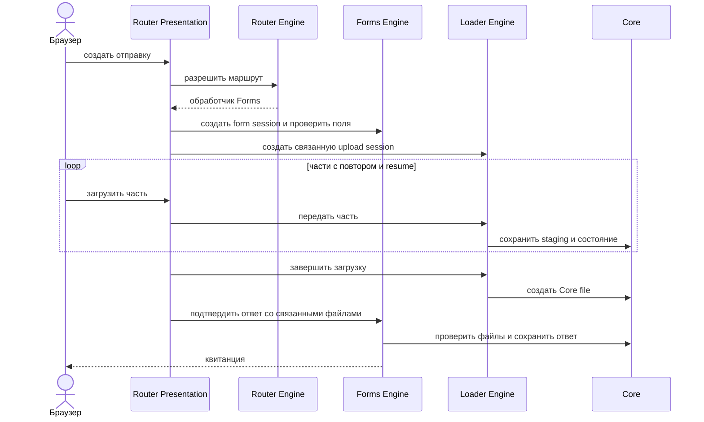

# Forms Engine: целевая спецификация

Статус: проект; общая архитектура и приоритет решений — [SPEC-coordinator-platform.md](SPEC-coordinator-platform.md). API и хранение ниже не означают готовой реализации.

## Модель и полномочия

Форма имеет генерируемый ID, название, статус, опубликованную версию модели, разрешённые способы отправки, лимиты и одну или несколько статичных Core access groups для ответов. Модель описывает поля, типы, обязательность, проверки, ограничения количества/объёма файлов и разрешённые медиаформаты. Версия модели фиксируется при открытии сессии; изменения модели не меняют смысл принятых ранее ответов. JSON payload двигателя версионируется; постоянные метаданные хранятся в `core.module_data` через capability Forms без собственного SQL.

Файлы ответа и вложений хранятся как Core files. Рекомендуемый контейнер ответа — отдельный неизменяемый JSON-файл со значениями и ссылками на Core file IDs; каждое вложение — отдельный файл. Индекс, статус и ревизия формы сохраняются в module data. Уровень 1 хотя бы в одной группе файла разрешает чтение, уровень 2 — операции записи и удаление. Само содержимое файла неизменяемо; замена требует новый file ID. Настройка групп требует действующих полномочий Core. Публичность ответа настраивается отдельным маршрутом Router; факт отправки формы не публикует ответ.

Configuration API аутентифицировано и публикуется на admin-порту при включённом компоненте. Если форма явно опубликована через Router, любой посетитель может отправить ответ без входа в систему. Это разрешение относится к отправке и не предоставляет права читать её результаты. Результаты и вложения доступны пользователям в соответствии с назначенными Core уровнями в группах файлов; Core проверяет права при обращении.

## Загрузка и отправка

Пользователь вводит поля, загружает вложения частями и подтверждает отправку. Браузер может выполнить это одним действием. Coordinator регистрирует единый Loader; Presentation вызывает Forms и Loader последовательно, не создавая зависимости между engines.

Ограниченная серверная capability связывает form session, upload session и файл; она привязана к операции и сроку. Точная криптографическая реализация требует проектирования; UUID сам по себе не полномочие. Presentation не принимает от клиента произвольные группы или идентичность Core. Сервер проверяет актуальную схему, группы, объём, MIME/содержимое и права на каждом критическом переходе. Job/session state durable; повтор с одинаковым idempotency key и fingerprint возвращает тот же результат, изменение тела — конфликт.

Промежуточные вложения и незавершённый ответ не видны как готовая отправка. Переход к `ready` возможен после успешного сохранения и проверки всех файлов; операции Core и module_data не считаются общей транзакцией. Восстановление после сбоя отслеживает точные созданные объекты и очищает только принадлежащие незавершённой сессии, не удаляя используемый файл. Ограничения частоты, числа сессий, размера, времени, типа содержимого и срока staging задаются конфигурацией.

Сессия формы и её загрузки могут возобновляться после перезагрузки страницы до истечения срока сессии; сервер повторно проверяет привязку к конкретной сессии и опубликованной схеме. После истечения срока посетитель начинает отправку и загрузку заново; незавершённые данные подлежат безопасной очистке, перенос вложений в новую сессию не выполняется. Снятие формы с публикации или изменение её схемы отменяет незавершённые сессии, запрещает их отправку и запускает безопасную очистку их временных и уже загруженных файлов. После приёма ответ неизменяем: пользователь с необходимыми групповыми правами может его просматривать или удалить. После обычного подтверждения удаления ответа окончательно удаляются ответ и все его вложения, в том числе их принадлежность другим группам и наборам. Протокол обязан сохранять durable состояние частично завершённого удаления и повторять оставшиеся шаги до завершения.

Ответы хранятся бессрочно до явного удаления. Автоматического срока истечения или удаления по возрасту нет.

## Приёмка

Проверить отправку без авторизации только через явно опубликованный маршрут, версионирование схем, прямые группы, отсутствие разглашения ответов, недоступный/чужой file ID, повторы и конфликты ключей, загрузку частей параллельно, после перезагрузки страницы и рестарта, прерывание каждой стадии, cleanup, лимиты, отказ Core, потерянный ответ commit, запрет редактирования и удаление пользователем уровня 2. Проверять на отдельных disposable ресурсах.
