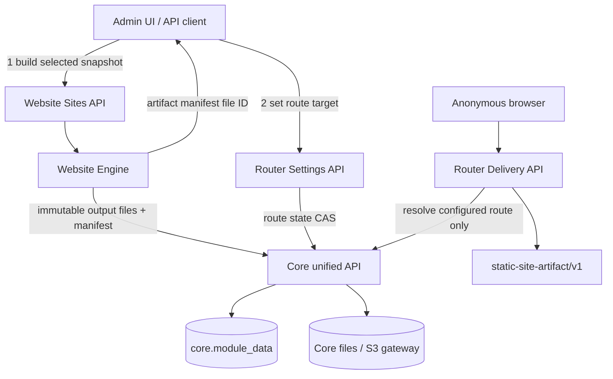
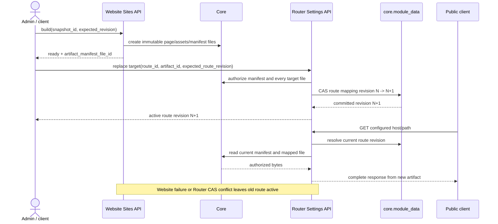

# Router Engine — целевая спецификация

Статус: согласованная целевая спецификация; Engine и HTTP адаптер остаются незавершёнными. Router v1 принимает только явную цель Core file или manifest `static-site-artifact/v1`; handler-маршрутов нет. Coordinator может автоматически переключать один route после успешной публикации, но это не меняет допустимые типы route targets. Cache по умолчанию `no-store`; fallback неявно не применяется. Общие правила Core и изоляции engine data определены в [SPEC-core-v2.md](SPEC-core-v2.md) и [SPEC-module-data.md](SPEC-module-data.md). Контракт статического сайта: [SPEC-static-site-artifact.md](SPEC-static-site-artifact.md). Сборка сайта и feature catalog: [SPEC-website-engine.md](SPEC-website-engine.md).

Router не зависит от Website и не понимает снапшоты, версии фич, manifest, Content или формы. Он принимает только общий файл либо нейтральный static-site artifact и сопоставляет явный публичный route с этой целью.

## 1. Ответственности и API

Router является отдельным engine module и предоставляет два раздельных внешних контракта:

1. **Settings API** — авторизованное управление соответствием ветки/host/path цели (один Core file или static-site artifact manifest), проверка конфликтов, чтение revision и атомарное переключение.
2. **Delivery API** — публичная выдача только по заранее сохранённым mappings. В URL нельзя передать произвольный Core file ID или module-data key.

Админский клиент сначала вызывает Website Sites API и получает `artifact_manifest_file_id`; затем отдельным запросом вызывает Router Settings API. Нет Website→Router или Router→Website вызовов.

## 2. Независимость от снапшотов и веток

Router не хранит `snapshot_id`, `feature_id`, Website build inputs, branch-to-snapshot assignment или Website status. Для Router целевая сущность — immutable Core file ID, содержащий один файл, либо Core file ID нейтрального artifact manifest.

Topology веток, публичные hostnames, порты, CORS/indexing policy и доступные branch IDs конфигурируются статически при запуске. Router не создаёт и не переименовывает ветки во время работы. Route records могут ссылаться только на объявленную ветку. Обновление snapshot/site выполняется так: Website строит новый artifact; клиент проверяет `ready`; Settings API атомарно переключает один route на новый artifact ID через CAS. Это две операции, а не распределённая транзакция. При ошибке CAS конкретный route сохраняет прежнее значение. Если клиент обновляет несколько routes последовательно, уже успешно обновлённые записи остаются новыми, а остальные сохраняют старые значения; клиент показывает частичный результат и может повторить оставшиеся операции.

Website snapshots никогда не передаются Delivery API и не разрешаются динамически на запросе. Так Router остаётся заменяемым и не связывает публичную раздачу с внутренней моделью Website.

## 3. Постоянная конфигурация

Route mappings хранятся Router в namespace `router` таблицы `core.module_data`, TTL `0`. Router владеет JSON payload и его версией; Core владеет физическим хранением и CAS. Локальный cache конфигурации допустим только как производный cache с проверкой revision/invalidation и fail-closed поведением, согласованным с [SPEC-module-data.md](SPEC-module-data.md).

Логическая запись маршрута включает:

- внутренний сгенерированный `route_id`;
- `branch_id` из startup config;
- нормализованный host scope (только из разрешённой конфигурации);
- канонический path/prefix и тип matching;
- `target.kind = core-file | static-site-artifact`;
- `target.file_id` — Core UUID, не URL пользователя;
- ожидаемую revision для CAS и audit metadata без секретов;
- только разрешённые cache/security-header policies;
- состояние `active` (чернового неявно публичного route нет).

Route records могут храниться отдельными CAS-документами. Каждая операция изменяет ровно один route; общей транзакции набора routes нет. Хранилище должно позволять детерминированно обнаруживать конфликты ветки/host/path до сохранения. TTL не используется.

### 3.1 Права на настройку

Settings API требует аутентификацию. Управление маршрутами ограничивается выделенной статической access group, например `router.routes`: уровень `1` даёт чтение конфигурации, уровень `2` — создание, изменение, переключение и удаление route. Эта группа объявляется в startup YAML; отсутствие группы или назначения означает отказ. Неявное право только из-за слова «admin» не возникает.

Router runtime использует отдельную обычную Core user identity с минимальными read grants для целевых файлов и artifact assets. Delivery API не получает обход авторизации Core. Если доступ runtime principal отозван, выдача закрывается при актуальной проверке Core.

Обновление route не может увеличить Core grants. Установка цели должна проверить, что Router identity имеет возможность прочитать файл/manifest и его допустимые dependencies. Если API не может безопасно проверить все права, target не активируется.

## 4. Settings API

Методы API ниже — семантический контракт, а не обязательные имена URL:

- `ListRoutes(branch, filter)` — только с уровнем чтения конфигурационной группы;
- `GetRoute(route_id)` — вернуть mapping и revision, не раскрывая недоступные Core objects;
- `CreateRoute(route_spec, idempotency_key)` — проверить host/path/branch/target, конфликт и Core grants;
- `ReplaceTarget(route_id, new_target, expected_revision)` — атомарный CAS target binding;
- `UpdatePolicy(route_id, policy, expected_revision)` — изменить только allowlisted serving/cache policy;
- `DeleteRoute(route_id, expected_revision)` — удалить mapping через явную аутентифицированную операцию.

Клиент получает `409 Conflict` на stale revision/route collision, контролируемую validation error на невалидный target и authorization error на недостаточный Core grant. Ошибка до CAS не меняет активный mapping. Повтор с тем же idempotency key и fingerprint возвращает исходный результат; другое тело с тем же ключом — конфликт.

Настроечное изменение сначала полностью валидируется и подготавливается, затем одной CAS операцией переключает route record/revision. Успешный ответ возвращается только после долговременной записи в Core module data. Инвалидация кеша другим процессам инициируется после commit; при недоступности инвалидации инстансы проверяют актуальную revision, а при невозможности проверки закрывают выдачу. Старое значение не используется как fail-open.

## 5. Delivery API

Запрос публично отдается, только если host + branch + path разрешились в активный route. Core files остаются приватными; публичный доступ возникает только в результате явного route binding. Передача ID файла клиентом не может создать route или получить доступ.

### 5.1 Matching и нормализация

- Host берётся из доверенной конфигурации reverse proxy/входного listener, с безопасной обработкой `Forwarded`/`X-Forwarded-Host`; не доверять произвольным forwarded headers.
- Branch определяется слушающим endpoint/статической конфигурацией, не user query/header.
- Path нормализуется ровно один раз: reject encoded separators/dot-segments, NUL и неоднозначную кодировку; привести percent encoding по единому алгоритму до matching.
- Route precedence фиксирован: exact match выше longest-prefix; равный конфликт запрещён до публикации. Не использовать порядок строк БД как порядок маршрутизации.
- Prefix target вычисляет только относительный путь внутри artifact manifest. `..`, абсолютный путь и неразрешённая запись manifest отвергаются.
- Никаких динамических callbacks, reverse proxy к произвольному адресу, произвольного Go handler или прямого пути к S3 в первой версии.

Для `core-file` Router отдаёт этот файл. Для `static-site-artifact` Router читает и проверяет нейтральный manifest через Core, разрешает путь в перечисленный `file_id` и затем читает этот файл. Путь без записи в manifest возвращает 404. Fallback возможен только при явно сохранённой route policy и указанном в manifest fallback; автоматическая выдача `index.html` запрещена.

### 5.2 HTTP-ответ и безопасность

- `Content-Type` берётся из проверенного allowlisted значения/manifest, а не из произвольного запроса; применяются безопасный charset и `X-Content-Type-Options: nosniff`.
- Content-Disposition по умолчанию `inline` только для разрешённых web types; иные файлы скачиваются как attachment с безопасным именем.
- ETag строится из checksum immutable file/manifest; conditional GET проверяется после разрешения route и актуальной Core авторизации.
- Range поддерживается только если Core streaming contract его безопасно реализует; в противном случае route отвечает без Range, не буферизуя неограниченный файл в памяти.
- Cache-Control по умолчанию — `no-store`. Более длительный cache допускается только после явной безопасной настройки route policy; приватные данные/authorization responses не попадают в shared CDN cache.
- CORS и indexing headers задаются веткой/route allowlist; значения из файла или запроса не могут установить произвольный origin/header.
- Внутренние Core IDs, ошибки S3, права, namespace и наличие закрытых файлов не раскрываются в публичном теле ответа.
- Ошибка Core/module-data проверки закрывает доступ. Недоступный объект не может быть доставлен из устаревшего Router byte cache.

## 6. Атомарная публикация маршрута

Website сначала создаёт и проверяет целый immutable artifact. Router при настройке проверяет его manifest и необходимые файлы. После этого route binding переключается одной CAS revision. Все последующие запросы разрешают либо старое, либо новое полное соответствие; частичный artifact не становится активным.

Atomicity распространяется на один route binding. Если UI переключает несколько независимых routes, она должна использовать bulk CAS/route-set revision или явно показывать частичное применение; последовательность отдельных update не объявляется атомарной.

Старый artifact после успешного switch остаётся доступным, пока Website не удалит его по собственным ссылкам и политикам retention. Router не удаляет файлы при смене target. Core не имеет глобального реестра engine references.

## 7. Сбои и наблюдаемость

- Не настроенный route возвращает обычный 404 без попытки угадывать Core ID.
- Конфликт route предотвращается при записи и повторно проверяется при загрузке state; повреждённая конфигурация закрывает конфликтующие mappings.
- Недоступность Core или module data не должна переводить route в произвольную выдачу/старый target без проверки актуальности.
- Ошибка загрузки одного artifact file возвращает контролируемую 5xx/404 политику без утечки внутренней детали; частично собранная HTML-страница не маркируется успешной.
- Метрики: route resolution hit/miss, Core authorization failures, revision conflicts, artifact-manifest errors, bytes streamed, request latency и invalidation lag. Логи не включают содержимое файлов, credentials и секреты.

## 8. Приёмочные проверки

Нужны unit/contract/integration и реальный HTTP/browser acceptance для:

1. явной публикации файла и запрета прямого доступа к тому же UUID вне route;
2. route на static artifact, base path, точного path mapping, query string, configured fallback и отсутствующего пути;
3. host/branch изолированности и статических branch IDs;
4. exact/longest-prefix matching, collision и одинакового prefix в разных ветках;
5. percent-encoded traversal/separators, malformed URL, spoofed Host/Forwarded headers;
6. access revocation, отсутствующей группы, stale local cache и отказа проверки revision;
7. параллельных replaceTarget с одинаковой expected revision: только один commit succeeds;
8. недоступного/частичного artifact, checksum/content-type mismatch и отказа до переключения;
9. старого route при Website build failure и CAS conflict;
10. cache headers, ETag/conditional GET, Range policy, CORS/indexing и безопасных response headers;
11. невозможности Router→Website RPC, произвольного handler или произвольного Core UUID в публичном запросе;
12. хранения route records только через Router-scoped Core module-data API.

Browser QA не отправляет writes в общий или production API. Используется уникальная изолированная конфигурация и disposable данные.

## 9. Зафиксированные решения

1. CAS и атомарность применяются к одной записи route. Последовательное обновление набора может завершиться частично и должно отображать это состояние клиенту.
2. Cache-Control по умолчанию — `no-store`; immutable cache задаётся только явной настройкой.
3. Неизвестный путь artifact возвращает 404. Любой fallback должен быть настроен явно; автоматического SPA fallback нет.
4. Router v1 не принимает handler callbacks, engine operation names или произвольные URL targets.
