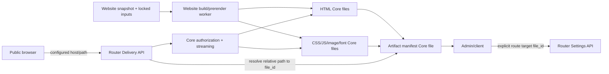

# Static Site Artifact v1 — нейтральный формат сборки

> **Уточнение:** [Coordinator и модульная платформа](SPEC-coordinator-platform.md) описывает двухэтапный prerender в `workers/` и автоматическое переключение Router. Указанные ниже ручной вызов и расположение worker внутри Website являются прежним вариантом; нейтральный формат artifact сохраняется.

Статус: предлагаемый engine-neutral контракт. Он позволяет Website Engine передать готовый статический сайт независимому Router Engine без вызова Router из Website. Router знает только этот формат и Core file IDs; он не интерпретирует snapshots, feature manifests или Website model.

Основной сценарий и сборка описаны в [SPEC-website-engine.md](SPEC-website-engine.md); назначение публичного route — в [SPEC-router-engine.md](SPEC-router-engine.md).

## 1. Цели и ограничения

- Артефакт полностью immutable после готового состояния.
- Содержимое каждой страницы и каждого ресурса хранится как отдельный Core file.
- Единственный входной объект — Core file, содержащий manifest `static-site-artifact/v1`.
- В manifest находятся относительные URL paths, Core file IDs, проверенные типы содержимого, checksum и размер.
- Артефакт не даёт прав и не делает Core files публичными; прочитать их может только авторизованная identity Router.
- Manifest не содержит snapshot/feature/branch semantics и не может указать URL, S3 key, путь локального диска или произвольный redirect.
- Создание/проверка артефакта полностью завершается до его привязки к публичному маршруту.



## 2. Manifest schema

Рекомендуемая сериализованная форма:

```json
{
  "format": "static-site-artifact/v1",
  "digest": "sha256:<digest-of-canonical-payload>",
  "entrypoints": {
    "/": "/index.html",
    "/about": "/about/index.html"
  },
  "files": {
    "/index.html": {
      "file_id": "<core-uuid>",
      "content_type": "text/html; charset=utf-8",
      "sha256": "<hex-digest>",
      "size": 1234,
      "cache_class": "document"
    },
    "/assets/app.abc123.js": {
      "file_id": "<core-uuid>",
      "content_type": "text/javascript; charset=utf-8",
      "sha256": "<hex-digest>",
      "size": 5678,
      "cache_class": "immutable"
    }
  },
  "fallback": null
}
```

Это логическая схема; точный JSON Schema/versioned Go contract фиксируется при реализации. `digest` рассчитывается однозначно по canonical payload без самого поля digest. `entrypoints` связывает URL route внутри artifact с записью `files`. `fallback` — `null` либо относительный путь из `files`; fallback применяется только если это разрешено route policy. Значения `cache_class` ограничены enum; Router отображает их на собственную безопасную HTTP cache policy.

Все ID генерирует Core. Поле `file_id` — UUID, проверяемый Core. Каждый файл manifest должен быть включён в один и тот же готовый artifact. Записи файлов нельзя переопределять запросом и нельзя резолвить по файловому имени на S3.

## 3. Правила путей и содержимого

- Artifact path начинается с `/`, нормализован в UTF-8 и представляет URL-relative path, а не путь ОС.
- Запрещены `.`/`..`, двойное неоднозначное декодирование, NUL, backslash, encoded separator и абсолютный URL.
- Слеши/percent encoding обрабатываются единообразно; дубли после нормализации запрещены.
- Manifest не содержит внешних redirect targets, произвольных response headers, template expressions, S3 URI и route registration commands.
- `content_type` выбирается из server-side allowlist и проверяется по реальным байтам/назначению. Для неизвестного типа Router использует attachment/nosniff или отклоняет artifact по политике.
- Checksum и `size` проверяются при упаковке; Router может сверять метаданные Core при публикации и при чтении в зависимости от Core contract.
- Один файл не становится публичным от присутствия в artifact. Доступ существует лишь во время публичного запроса через активный Router mapping и Router Core identity.
- Один и тот же Core file ID может быть использован в нескольких artifact paths только при явном разрешении и совпадении metadata; по умолчанию дублирующие пути считают ошибкой build.

Маршрут Router имеет собственный base path. После сопоставления Router удаляет base prefix одним проверенным шагом и разрешает остаток только в `files` или `entrypoints`. Query string не меняет file mapping, если отдельный будущий контракт явно не добавит query routing.

## 4. Построение, проверка и жизненный цикл

Website создаёт страницы и ресурсы как Core files, собирает manifest последним, проверяет все ссылки и получает immutable Core file ID manifest. В build record сохраняются digest входов, manifest ID и результат проверки. Manifest artifact не может быть активирован, пока:

1. все target file IDs существуют и читаются Website build identity;
2. все paths каноничны и уникальны;
3. все entrypoints и fallback ссылаются на существующие HTML files;
4. checksum и размеры сходятся с Core metadata;
5. допустимы content types и лимиты количества/общего размера;
6. HTML/assets соответствуют runtime output policy;
7. Router runtime identity имеет актуальные read grants на необходимое содержимое для предполагаемого route.

Проверка Router не создаёт зависимости на Website. Из artifact manifest нельзя получить Website snapshot ID и по нему запросить дополнительные данные.

Artifact ID — Core file ID manifest. Успешное создание artifact не активирует публичный доступ. Клиент задаёт/обновляет Router binding отдельным вызовом. Смена route не удаляет старый artifact и его файлы. Очистку завершённых неиспользуемых сборок выполняет Website согласно своему сроку хранения и собственным ссылкам; Core не поддерживает глобальный reference registry.

## 5. Выдача

При запросе Router:

1. определяет статический branch scope и находит активное route binding;
2. подтверждает свежую revision route state и права своего Core principal;
3. читает artifact manifest через Core и проверяет поддерживаемый `format`/schema;
4. приводит путь запроса к канонической форме;
5. находит точный entry в `files`, либо явный entrypoint/fallback по настройке;
6. читает соответствующий Core file потоком;
7. применяет только безопасные headers/cache policy Router и возвращает байты.

При неизвестной версии формата Router не пытается угадать поля и не отдаёт содержимое. Отсутствующий target file не раскрывает внутренний UUID. Устаревший manifest/route cache не используется, если актуальность и авторизация не подтверждены.

## 6. Проверки совместимости

Контракт фиксируется тестовыми fixtures: минимальная index page, вложенная страница, versioned assets, fallback, пустой/слишком большой manifest, дубли нормализованных paths, неизвестная версия, отсутствующий Core file, неверный digest, запрещённый MIME и revoked access. Fixtures являются данными для проверки, не живыми публичными файлами.

Проверка реализации должна подтвердить, что Website может собрать artifact без Router; Router может раздать artifact без знания Website; Core access revocation сразу закрывает выдачу; и route switch на новый artifact сохраняет прежнюю выдачу при любой ошибке до успешного CAS.
