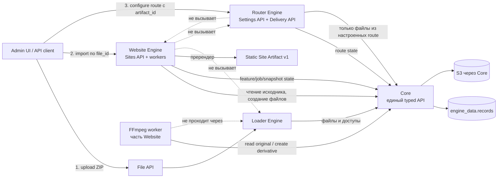
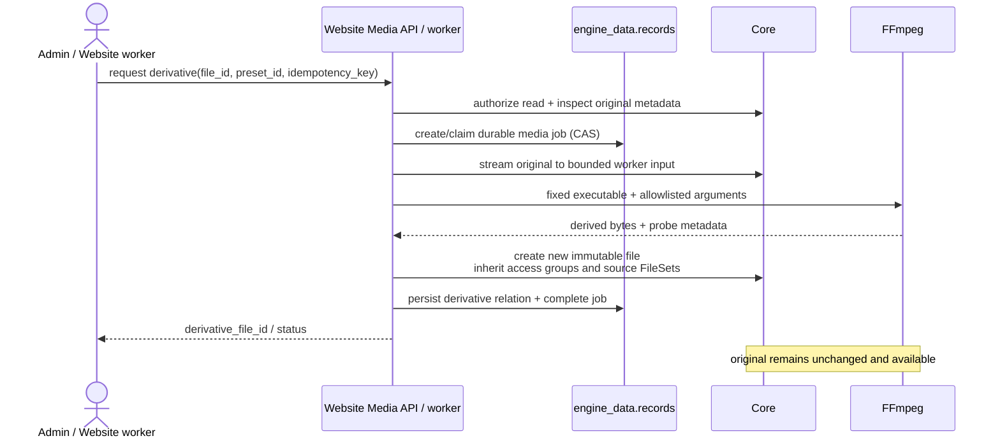

# Website Engine — целевая спецификация

> **dev_v2:** Приоритет имеют новый ABI, независимые workers и автопубликация через Coordinator: [SPEC-coordinator-platform.md](SPEC-coordinator-platform.md). Website создаёт FileSet по конфигурации. Старые ABI не поддерживаются; прежние разделы ниже требуют переработки.

> **Уточнение целевой архитектуры:** [Coordinator и модульная платформа](SPEC-coordinator-platform.md) заменяет прежние утверждения этого документа о FFmpeg и prerender внутри Website, ручной публикации и составе сборки. Воркеры находятся в `workers/`, публикацию координирует Coordinator; детали ниже сохраняются как материал для последующей полной переработки.

Статус: согласованная целевая спецификация независимого Website Engine; реализация приложения и HTTP API не завершена. Для общих правил Core и хранения engine-данных применяются [SPEC-core-architecture.md](SPEC-core-architecture.md) и [SPEC-module-data.md](SPEC-module-data.md); исторический [SPEC-core-v2.md](SPEC-core-v2.md) описывает только прежнюю реализацию. Нейтральный формат результата статической сборки описан в [SPEC-static-site-artifact.md](SPEC-static-site-artifact.md), публичная маршрутизация — в [SPEC-router-engine.md](SPEC-router-engine.md), границы внешних адаптеров — в [SPEC-engine-apis.md](SPEC-engine-apis.md). Целевой runtime поддерживает только новый ABI с lifecycle `render / hydrate / update / dispose`; ZIP Vitasil адаптируются до импорта. Старые ABI ниже — историческая справка, а не target-контракт. См. актуальный target раздел в [SPEC-feature-runtime.md](SPEC-feature-runtime.md).

Эта спецификация уточняет ответственность Website и запрещает прямые зависимости Website от Loader, Router и других движков. Старые абзацы общей спецификации, где Router вызывает обработчики движков или Website автоматически назначает маршрут/снапшот, должны трактоваться с учётом этой границы: публикация в Router выполняется отдельным API-вызовом клиента/админки.

### Target Sites API: branches and snapshot assignment

Branch topology is static startup configuration: API clients may list configured branches but cannot create, rename, enable, or change their listener address, CORS origins, or indexing policy. Each configured branch is associated with one site. Website returns stable internal branch IDs, the site association, and the current independent snapshot assignment. Assignment is an authenticated, explicit `PUT` guarded by both the branch's expected revision and the selected snapshot's expected revision; it records a durable branch event and returns the new branch revision. The API exposes a cursor-paginated branch event history. Assignment and history require write/read access to the configured `features` group respectively. A branch assignment does not mutate another branch, the snapshot, Content state, or a Router route.

Snapshot administration is also available through the Sites API. Listing is cursor-paginated and may be filtered to a configured `site_id`; detail includes the complete Website-owned structure, metadata, and design-system payload. `POST /api/v2/admin/sites/snapshots` requires a client idempotency key, a name, a full payload, the expected Website parent revision, and—when creating a child—the expected parent Content revision. Root creation has no `parent_id`; it does not copy Content data. Child creation names its parent and starts the durable snapshot-fork workflow described in [SPEC-content-engine.md](SPEC-content-engine.md). `expected_content_revision` is an input to the Content copy step; Content, not Website, checks that revision. Website creates the child in `provisioning`; only workflow finalization makes it `ready`. The API rejects duplicate JSON object keys and oversized or non-object payload sections before calling Website; Website still validates the versioned domain schemas. `DELETE /api/v2/admin/sites/snapshots/{id}` requires the current snapshot revision in `If-Match`; Website enforces branch protections and atomically reparents children where deletion is allowed. These operations require write access to the configured `features` group, while listing/detail require read access. The source of valid site IDs for root snapshots is the static site/branch configuration; the Admin must not invent sites from client input.

Snapshot payload changes are immutable. The Sites API does not expose an operation that edits a feature pin or structural field in-place; Admin creates a child snapshot with the desired complete payload. Branch assignment and build reject a `provisioning` or failed child. If the Content copy or finalization task fails, the parent, existing branch assignments, and current public artifact remain unchanged. The workflow is retried through its durable Coordinator tasks or the incomplete child is explicitly removed.

## 1. Назначение и границы

Website Engine управляет статическими фичами и сайтами, построенными из этих фич. В его область входят:

- каталог и версии фич;
- асинхронный импорт ZIP-фич, загруженных ранее через File API;
- разрешение зависимостей и фиксация точных версий фич в снапшоте;
- модель структуры сайта и настройки, принадлежащие Website;
- сборка и пререндер статических страниц;
- создание неизменяемого статического артефакта;
- асинхронная обработка медиа через FFmpeg;
- запись собственных состояний и метаданных через scoped API Core.

Website не владеет PostgreSQL, схемой БД, SQL, S3, файловыми байтами, протоколом загрузки, публичной маршрутизацией и сетевым API Router. Он не вызывает API других движков. Сборку запускают Site Admin API или внутренний worker Website; результат возвращается вызывающему клиенту как идентификатор статического артефакта. Клиент при необходимости отдельно передаёт этот идентификатор Router Engine.



Схема показывает три самостоятельных запроса клиента, а не цепочку синхронных вызовов между движками. Успешная загрузка через File API сама по себе не импортирует фичу и не публикует сайт.

## 2. Модульные границы

| Часть | Ответственность |
|---|---|
| File API + Loader | Приём байтов, загрузочные сессии и создание исходного Core-файла. Не распаковывает Website ZIP. |
| Website Sites API | Импортирует фичу по существующему `file_id`, управляет каталогом, снапшотами и заданиями сборки. Клиент не выбирает FileSet. |
| Website workers | Распаковка и проверка фич; пререндер; FFmpeg. Все файловые операции идут в Core. |
| Core | Единственный API доступа к файлам, правам, наборам и module data; единственный владелец PostgreSQL и S3. Не знает терминов «сайт», «фича», «снапшот», «пререндер» и «FFmpeg». |
| Router Settings API | Сохраняет явное соответствие публичного маршрута Core-файлу или статическому артефакту. Не знает, какой движок его создал. |
| Router Delivery API | Отдаёт только цели, опубликованные в конфигурации Router, используя авторизованную идентичность Core. |

Все внешние пользовательские API фич, сайтов, файлов и маршрутов независимы. Общая админка может предоставить единый экран, но orchestration в ней — последовательность отдельных API-вызовов и не создаёт скрытой связи движков.

## 3. Данные Website

Вся долговременная engine-специфичная информация записывается в `engine_data.records` через capability модуля `website`. PostgreSQL JSONB — физическое хранилище, но модели, версия JSON-контракта, проверка и upcast принадлежат Website. У записей каталога, снапшотов, импорта, пререндеров и FFmpeg TTL равен `0` (без истечения срока). Временное исполнение worker не является источником истины.

Рекомендуемые типы документов в пространстве Website:

- `feature-version`: идентификатор фичи и точная версия, извлечённый manifest, хеш manifest и пакета, зависимости, карта относительных путей на Core file IDs, состояние готовности и provenance;
- `feature-import-job`: исходный file ID, созданный Website FileSet ID, ключ идемпотентности, фазы, созданные file IDs, ошибка безопасного класса, попытки и timestamps. Публичное состояние задания — `queued`, `running`, `succeeded`, `failed` или `cancelled`; внутренние этапы импорта остаются отдельным полем прогресса;
- `snapshot`: родительский снимок, revision, site structure/settings, набор точных `feature_id@version` и lock разрешённых зависимостей;
- `render-job`: snapshot revision, render input digest, состояние и artifact manifest file ID;
- `media-job`: исходный Core file ID, хеш, preset с версией, состояние, производный file ID и ошибки;
- `media-derivative`: связь оригинала с профилем и неизменяемым производным файлом.

Имена ключей и селекторы регистрируются композицией и ограничены namespace/scopes модуля. Клиент не может передать `module_id`, scope другого движка или произвольный selector. CAS, revision, batch и селекторы применяются согласно [SPEC-module-data.md](SPEC-module-data.md). Идентификаторы генерируются сервером.

### 3.1 Файлы и доступ

Core остаётся единственным источником байтов и решений об актуальном доступе. Website хранит только ссылки на файлы и собственные метаданные. Любая операция чтения, создания, связывания с группой/набором или удаления вызывает соответствующую операцию Core; Website не кэширует решение о доступе как полномочие.

Файлы остаются неизменяемыми. Изменённые байты — новый Core file ID. Метаданные фичи могут обновляться по правилам module-data, но это не переписывает файл.

Статические access groups задаются конфигурацией при запуске; права прямые, уровни `0/1/2`. Динамический FileSet предназначен для поиска/организации и не выдаёт доступ к файлам. На каждый импорт Website создаёт ровно один FileSet версии с управляющей группой из своей конфигурации. Клиент не передаёт FileSet ID или access group. После полной проверки ZIP Website добавляет исходный архив в набор, затем архив и все извлечённые файлы; членство не открывает доступ к байтам. Каждый извлечённый файл наследует статические access groups исходного файла. Другие FileSets исходного архива не копируются.

## 4. Контракт feature ZIP

ZIP является статическим пакетом, а не исполняемым серверным модулем. Импорт не запускает shell-команды, install hooks, пользовательские бинарники или build scripts. Runtime JavaScript/CSS исполняется только в предназначенном браузерном/runtime-контексте и в изоляции, предусмотренной ABI.

В корне пакета находится `manifest.json`. Он остаётся контрактным источником для:

- стабильного `feature_id`, имени, версии и описания;
- ABI и его версии;
- файлов runtime, entry points и статических ресурсов;
- `arguments` — графически настраиваемых значений размещения;
- типизированных `dataInputs` и формы submission, если они поддерживаются ABI;
- декларации feature dependencies с точными или разрешаемыми версиями;
- design tokens и деклараций предоставляемого design/UI контракта;
- имён безопасных FFmpeg presets, которые может запросить фича;
- ограничений prerender/runtime, необходимых опубликованной версии manifest.

`manifest.json` не содержит секретов, произвольных путей файловой системы, произвольных команд и значений, позволяющих выключить системные лимиты. Каталог хранит проверенную проекцию manifest и ссылки на извлечённые файлы; полный ZIP после завершения импорта не хранится.

### 4.1 Зависимости и дизайн-система

Фичи используют общие UI и дизайн-контракты декларативно, через manifest. Предлагаемая модель:

1. Общая UI/design feature публикует версионированный контракт: tokens, CSS variables, компоненты/runtime assets и API совместимости.
2. Потребительская фича объявляет provider и диапазон/точную версию контракта в manifest.
3. Resolver проверяет дерево зависимостей, несовместимые ограничения и циклы.
4. Snapshot фиксирует разрешённые точные версии всех providers; render/build не использует плавающие версии.
5. Сборка встраивает только ресурсы зависимостей, на которые ссылаются фичи снимка; порядок и конфликты разрешаются детерминированно.

Манифест потребителя может ссылаться только на публичный контракт провайдера, не на его внутренние пути или внутренние структуры. Tokens namespaced по provider. Override применяется только там, где provider объявил token overridable; неопределённый token или несовместимая версия — ошибка проверки снапшота/сборки до публикации. Значения по умолчанию объявляются в manifest; общие пользовательские изменения остаются snapshot-scoped.

Website валидирует только новый целевой ABI и его явную версию в manifest. Исторические `legacy-react-v1`, `static-module-v1` и `static-html-v1` не запускаются напрямую: ZIP адаптируется до импорта или отклоняется с контролируемой ошибкой. Нельзя угадывать ABI по содержимому архива, молча менять lifecycle или принимать неизвестные версии.

## 5. Импорт фичи из файла

### 5.1 Контракт операции

1. Оператор/пользователь загружает ZIP через File API. File API вызывает Loader, а Loader создаёт исходный файл в Core и возвращает его UUID.
2. Клиент вызывает Sites API с `source_file_id`, idempotency key и, при необходимости, ожидаемым digest. Тело не принимает ZIP bytes, FileSet ID, access group, Core namespace или module ID. Digest служит дополнительной проверкой и не заменяет Core checksum.
3. Sites API аутентифицирует пользователя и проверяет его право читать исходный файл. Website проверяет, что service identity имеет доступ к группам исходника и `FileSet`-management group из своей конфигурации, создаёт долговременную job-запись и возвращает `202 Accepted` с `job_id` и текущим состоянием.
4. Worker Website потоково читает исходный ZIP через Core и полностью проверяет central directory, содержимое и manifest. Только после полной валидации Website сам создаёт ровно один FileSet версии с управляющей группой из конфигурации и добавляет исходный архив в него. Клиент не выбирает и не передаёт FileSet ID.
5. Для каждого извлечённого объекта Worker создаёт новый immutable Core file с группами исходника, добавляет его в тот же FileSet и записывает ID/результат шага в durable job state. Все повторяемые Core операции имеют стабильный idempotency key.
6. Worker проверяет полноту состава FileSet, размеры и checksum файлов, затем переводит job в `source_cleanup_pending`. Частичные результаты не видны в каталоге как готовая версия.
7. После успешной проверки Website удаляет членство исходного ZIP в FileSet и окончательно удаляет сам Core file. Если любая операция очистки временно не удалась, job остаётся в `source_cleanup_pending`; worker повторяет точные шаги без повторного чтения уже удалённого исходника.
8. Только после подтверждения удаления исходника Website одной atomic batch/CAS операцией регистрирует версию как `ready` и завершает job. В каталоге остаются digest и provenance, но нет живой ссылки на ZIP. Повтор не создаёт дубликаты и не пытается читать удалённый файл.

Операция импорта не активирует фичу автоматически, не создаёт snapshot и не вызывает Router. Готовая версия появляется в каталоге и явно выбирается в snapshot.

```mermaid
sequenceDiagram
    actor A as Admin / client
    participant F as File API
    participant L as Loader Engine
    participant C as Core
    participant S as Website Sites API
    participant W as Website import worker
    participant D as engine_data.records

    A->>F: upload ZIP
    F->>L: upload protocol
    L->>C: create immutable source file
    C-->>A: source_file_id
    A->>S: import(source_file_id, idempotency_key)
    S->>C: authorize source read + metadata
    S->>D: CAS create import job (TTL=0)
    S-->>A: 202 job_id / state
    W->>D: claim job by CAS
    W->>C: stream source archive
    W->>W: validate manifest + ZIP entries
    W->>C: create version FileSet using configured management group
    loop each allowed archive entry
        W->>C: attach source + extracted files to Website-created FileSet<br/>inherit source access groups
        W->>D: persist output file ID / progress
    end
    W->>D: mark outputs verified; stage = source_cleanup_pending
    W->>C: permanently delete source ZIP
    W->>D: atomic batch: register feature ready + mark job complete
    Note over W,D: ready is exposed only after outputs are verified<br/>and source cleanup has completed
```

### 5.2 Состояния и повтор

Рекомендуемая state machine:

```text
queued -> reading -> extracting -> verifying -> source_cleanup_pending -> ready
   |         |           |             |                 |
   +---------+-----------+-------------+-----------------+-> retryable_failed
   +-------------------------------------------------------> rejected
```

- `queued`: durable job создана;
- `reading`: Core авторизовал и открыл источник;
- `extracting`: создаются Core files; каждому созданному UUID сразу находится место в durable job;
- `verifying`: сверяются manifest, хеши, набор файлов, зависимости и результат записи;
- `source_cleanup_pending`: версия и файлы проверены, выполняется окончательное удаление ZIP;
- `ready`: версия каталога пригодна к выбору;
- `retryable_failed`: временная ошибка Core/S3/БД; повтор с сохранением progress;
- `rejected`: ZIP/manifest небезопасен или некорректен; повтор без изменения входа не исправит ошибку.

Повтор с тем же idempotency key и тем же fingerprint возвращает ту же job. Тот же ключ с другим `source_file_id`/fingerprint — конфликт. Одновременно обрабатывает job только один worker lease/revision. Истёкший lease может быть перехвачен; все Core file create/delete операции и обновления module-data обязаны иметь идемпотентный способ сверить уже созданный шаг. При неоднозначном результате операции worker сначала читает её состояние через Core/module data, не создавая копии вслепую.

Регистрация версии и переход job должны использовать atomic batch/CAS внутри `engine_data.records`, где это возможно. Core file operations не транзакционны вместе с module data, поэтому job сохраняет шаги и UUID до перехода дальше. Ошибка записи после создания файла приводит к reconciliation/удалению принадлежащего этой job осиротевшего файла, а не к выдаче частичного feature version.

### 5.3 Проверка ZIP и отказоустойчивость

До создания распакованных файлов полностью проверить центральный каталог и manifest с потоковым лимитированным чтением. Минимальные запреты и ограничения:

- запрещены абсолютные пути, `..`, NUL, обратные слеши в переносимом пути, неоднозначная нормализация и выход за корень;
- запрещены symlink, hardlink, специальные типы файлов и дубли путей после нормализации;
- ограничены число entries, размер ZIP, суммарный распакованный объём, размер одной записи, коэффициент сжатия, длина пути и время обработки;
- разрешены только ожидаемые типы файлов; бинарники/скрипты не исполняются на сервере;
- manifest должен соответствовать версии schema/ABI и ссылаться только на существующие файлы внутри архива;
- идентичные `feature_id@version` с тем же package digest — идемпотентный no-op/результат существующей версии; другой digest для того же immutable identity — конфликт, пока явно не выбрана новая версия;
- ошибка или отмена не делает частичные результаты видимыми как готовую фичу;
- логи содержат job ID и безопасный класс ошибки, не секреты и не произвольные содержимые пользовательских файлов.

После crash/restart worker возобновляет job по durable progress. Reconciliation сверяет ссылки job с фактическими файлами Core; файлы, которые job создала, но не включила в готовую версию, могут быть удалены только после проверки принадлежности этой конкретной job. Core не ведёт глобальный reference registry.

## 6. Снапшоты и сборка сайта

Website владеет сайт-структурой и снимками конфигурации в собственном namespace. Снапшот хранит ссылки на feature IDs и точные версии, настройки страниц/маршрутов сайта, размещения и их manifest-defined arguments/data bindings, а также lock точного дерева dependencies. Он не копирует байты фич и не меняет Core access groups.

Переходы снимков следуют принятой модели платформы: структурные/design изменения создают дочерний snapshot; публикация содержимого (если соответствующий Content Engine подключён) остаётся ответственностью Content и входит в сборку как отдельный входной revision. Website не импортирует данные Content напрямую из его БД — переданные входы должны идти через объявленный typed contract либо через композиционный интерфейс. Снапшот Router не содержит и Router не выбирает.

Изменения в feature catalog не меняют уже существующие snapshots. Обновление зависимости требует явной операции изменения snapshot и фиксирует новую точную версию. Удаление feature version, используемой существующими snapshots/builds, должно быть запрещено или безопасно скрыто из нового выбора; оно не переписывает прошлые ссылки.

Build принимает snapshot ID + ожидаемую revision и идентификатор входного набора контента, если он нужен. Worker фиксирует immutable build input digest: snapshot revision, точные feature package hashes, lock дерева зависимостей, runtime ABI versions, design tokens и revision опубликованного контента. Изменение любого входа создаёт новый build key.

Build проходит стадии `queued -> resolving -> prerendering -> packaging -> verifying -> ready`; ошибка/отмена не затрагивает ранее готовые artifacts. Успешная сборка возвращает `artifact_manifest_file_id` и summary. Она не переключает публичный route и не меняет Router configuration.

### 6.1 Prerender

Результат пререндеринга — реальные HTML-файлы страниц с готовым markup feature placements, подходящие для initial paint. Browser runtime v2 выполняет `hydrate` поверх готового markup и не заменяет его. Для каждого placement создаётся ровно один нейтральный lifecycle root. Старые ABI не входят в требования совместимости Website v2; поведение runtime, определённое в [SPEC-feature-runtime.md](SPEC-feature-runtime.md), применяется лишь там, где оно не противоречит ABI v2.

Prerender должен быть детерминируемым для неизменных входов, если данные не объявлены внешне изменяемыми. В build digest включаются все фактические входы. Внешние запросы разрешены только при явной декларации/allowlist, с timeout, размерными пределами и блокировкой loopback, private, link-local и metadata адресов; иначе worker не имеет сетевого доступа. Ошибка одного placement не должна молча выдавать ложный завершённый snapshot: build завершается контролируемой ошибкой или явно разрешённым manifest fallback.

Worker запускает feature code только в изолированном ограниченном Chromium/runtime процессе, с лимитами CPU, памяти, времени, числа вкладок и размера результата. Разделяются origin/context фич, если ABI это требует. Секреты окружения и внутренние Core credentials не доступны коду фич. Итоговая HTML-страница и assets сохраняются как отдельные неизменяемые Core files и перечисляются в статическом artifact manifest.

## 7. FFmpeg и производные файлы

FFmpeg входит в Website Engine как отдельная worker capability и работает непосредственно с Core files через тот же единый Core API. Loader не участвует в конвертации. Оригиналы остаются неизменными и не удаляются при назначении производного файла.

Запрос обработки создаётся асинхронно при явном запросе или по безопасному preset, объявленному фичей. Клиент передаёт Core file ID и имя разрешённого preset, не shell args, путь к файлу или произвольные параметры FFmpeg. Операционная конфигурация YAML включает allowlist presets/форматов, лимиты входа/выхода, CPU/память/время, число workers и временную область. Числа и значения должны валидироваться при старте; скрытых ослабляющих defaults нет.



Job/cache identity включает original checksum, preset ID и preset config version. Повтор идентичного запроса возвращает существующую задачу/производный файл, если он ещё существует и доступен. Изменение preset создаёт новый derivative. Производный файл — новый UUID, наследует текущие статические access groups оригинала и добавляется в те же согласованные FileSets; членство в наборе не открывает файл.

FFmpeg запускается без shell, с фиксированным executable, аргументами из кода/preset registry, закрытым окружением и временной директорией. Проверяются входные stream types, длительность/размер/число stream, кодеки, фактический output MIME/container и лимиты. Никакое имя, путь, filter graph, URL или параметр от пользователя не конкатенируется в командную строку. Поддержка сетевых input/protocol отключена, если отдельный безопасный сценарий явно не разрешён.

Состояния: `queued -> probing -> processing -> validating -> storing -> ready`, а также `retryable_failed`, `rejected`, `cancelled`. Частичный output никогда не публикуется как файл; временные данные очищаются в `finally`/reconciliation. Ошибка FFmpeg не влияет на оригинал или другие derivatives.

## 8. Безопасность и проверяемые инварианты

- Каждое файловое действие авторизует Core в момент операции; cached Website metadata не заменяет проверку прав.
- Пользовательский API принимает file IDs, но не пути S3, Core namespace, module identity, executable path или arbitrary ffmpeg args.
- Website service identity имеет минимальные grants только на необходимые статические группы и операции; отсутствие группы в конфигурации не даёт доступ.
- Импорт, prerender и FFmpeg имеют concurrency/resource limits, cancellation и durable recovery.
- Необработанные пользовательские HTML/JS/CSS не считаются доверенным HTML; границы доверия и CSP устанавливаются runtime/presentation.
- Секреты не входят в feature packages, logs, manifests, prerender environment и artifact manifest.
- Удаление файла — окончательное действие. Сначала Website проверяет собственные ссылки, а общие файлы удаляет только согласованный ответственный workflow. Core не проверяет engine references.
- Ошибки внешнего API не раскрывают существование недоступного Core file или содержимое приватной фичи.

### 8.1 Приёмочные проверки

До объявления Website готовым потребуются unit/contract/integration проверки как минимум для:

1. повторного import с одинаковым и конфликтующим idempotency key;
2. ZIP traversal, symlink, duplicate normalized names, bomb, oversized entries, bad manifest и контролируемый отказ legacy/неизвестного ABI;
3. worker crash после каждой внешней Core operation и возобновления без дублей/утечки частичных версий;
4. отказа удаления исходного ZIP и идемпотентного cleanup;
5. Core authorization/revocation до чтения и при создании выходных файлов;
6. dependency cycle, несовместимой версии, воспроизводимого lock snapshot и стабильного build digest;
7. prerender markup, hydration поверх готового HTML, сетевой SSR sandbox и запрета доступа к private network;
8. render/build failure без переключения активного Router binding;
9. FFmpeg invalid media, timeout, quota, worker restart, повтор job, preset allowlist, отсутствия shell injection и сохранения original;
10. ровно одного целевого FileSet, наследования access groups и отсутствия прав доступа, полученных из FileSet membership;
11. отсутствия SQL/S3/direct engine calls и чтения чужого module-data namespace;
12. сбора метрик для queue depth, latency, retries, rejected packages и cleanup backlog без утечки содержимого.

Для интеграционных проверок используются отдельные disposable PostgreSQL/S3 ресурсы, перечисленные в QA отчёте. Проверки реального браузера/Chromium и текущих Vitasil ZIP фиксируются отдельно; отсутствие среды не считается успехом.

## 9. Открытое проектное решение

Общий UI/design provider задаёт публичные Website фичи через manifest-зависимость и версионированные tokens/assets. Admin UI использует тот же provider. Встроенный минимальный Admin fallback обеспечивает вход и восстановление ранее загруженной совместимой версии provider. Выбор версии сначала проверяет совместимость и сразу переключает Admin; затем Coordinator отдельно пересобирает затронутые опубликованные сайты в дочерние снапшоты. Ошибка оставляет сайту прежнюю публикацию и требует ручного повтора. Если публикация сайта изменилась во время сборки, устаревший результат отбрасывается и сборка повторяется от новой публикации. Несколько маршрутов одного сайта переключаются отдельно и могут ссылаться на один созданный дочерний снапшот.
