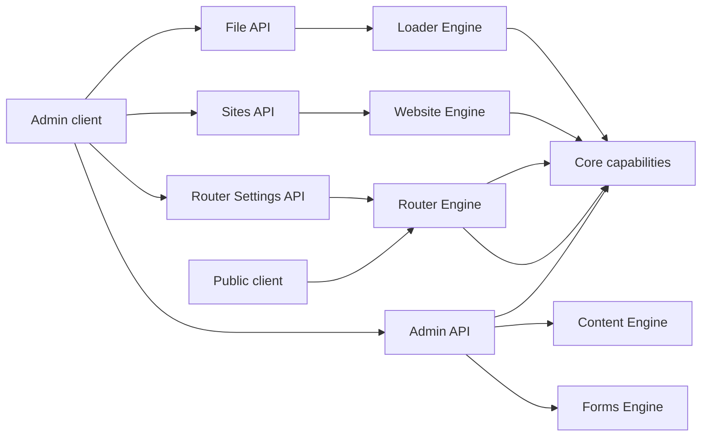

# Engine and Presentation API contracts

> **dev_v2:** Coordinator lives inside Core. Build profiles select engines, workers and API entrypoints; they do not add a separate Coordinator runtime component. The optional Coordinator Admin API is currently mounted on the shared File API listener and still applies Core group authorization. Router can dispatch only typed public operations registered in the compiled profile; operation routes are explicit and never arbitrary callbacks/URLs. Public upload operations use Loader. See [SPEC-coordinator-platform.md](SPEC-coordinator-platform.md) for composition and [SPEC-router-engine.md](../engines/router/SPEC-router-engine.md) for the Router contract.

Status: target boundaries are agreed. Generic credential-bound Core sessions, shared Admin cookie transport, v2 HTTP adapters and OpenAPI contracts for File/Identity/Coordinator/Sites/Content/Forms/Router are present. Runtime composition includes Core, Coordinator, Loader, File API, Identity and Coordinator Admin, Router Engine/Admin, a public Router listener, and the registered Loader-backed `public.form-upload` operation. Website, Content, and Forms production runtime factories remain absent and fail closed when selected; their Admin APIs are exposed only by an explicitly selected, synthetic read-only `development-fixtures` profile. The fixture profile is never implicit. The Admin feature registry uses the Sites catalog and durable feature-import jobs. Typed clients use centralized cookie/CSRF, idempotency, and revision handling. Feature catalog/import, Content records, Forms submissions, Router routes, and access management use v2 clients. Dashboard and Settings use direct group grants; structural Website editors and parts of Content/Forms workflows remain incomplete. Router's typed operation catalog, route validation, exact file routes, static-page artifact delivery, and Loader upload staging are implemented in the composition. Public file download remains a separate exact-path route bound to one configured `file_id`. Run one Router process per branch; the selected `branch_id` and listener address are process-local, while shared Core/Coordinator settings and the compiled profile must match. Router has no request-rate limiter. Any deployment exposing public routes must keep the listener private behind an external proxy; the proxy choice, configuration, and admission policy belong to the deployer and are outside this repository. Focused Admin and standalone Router checks, including an auth-only browser session, are recorded in [QA_REPORT.md](../../docs/QA_REPORT.md). The new regression allowing deployment-selected listener addresses awaits final verification; full workspace, runtime, and production checks remain deferred until the implementation sweep ends. Engine-specific rules are in [SPEC-website-engine.md](../engines/website/SPEC-website-engine.md), [SPEC-router-engine.md](../engines/router/SPEC-router-engine.md), [SPEC-core-v2.md](../core/history/SPEC-core-v2.md), and [SPEC-module-data.md](../core/SPEC-module-data.md).

## Current implementation boundary — 18 November 2026

The current `main/` production composition has factories for Core, Loader, File API, Identity Admin, Coordinator Admin, Router Engine/Admin, and the public Router listener/upload operation. `admin.identity` and Router Admin share the authenticated File API listener and Core session capability. Website, Content, Forms and their product-specific workers still have no production factories; the explicit development-fixtures profile provides synthetic reads and rejects writes instead of exposing a partial persistent system.

Sites, Content, Forms, and Router HTTP adapters are independently buildable packages with v2 route validation and cookie/Bearer transport. Content, Forms, Sites, and Router pagination/request limits are explicit startup settings, not handler defaults. Router branch selection is process-local so one process can serve each statically configured branch without changing the common Coordinator fingerprint. The fingerprint regression and explicit fixtures profile are added but remain unverified. No integration or browser result is implied by the presence of these adapters.

## Target composition root and message bus

The only executable/build-and-run entrypoint for the new platform is the static composition root in `main/`; the legacy product remains isolated under `legacy/`. Engines, workers, Core, and Presentation modules remain independently buildable/testable libraries, not separate product binaries. A process-local typed synchronous request/response dispatcher in `main` routes only statically registered contracts from the independent root `pkg` module (`pkg/contracts`) to explicitly scoped Core adapters. It has no durable state, does not route engine-to-engine calls, and does not replace Core Coordinator. Durable workflows, retries, leases, and restart recovery remain Core-owned. The `full` profile is a runnable production composition: every selected engine, worker handler, API, and UI factory must be registered and ready before any listener opens. This target is not met by importing a package or by a synthetic fixture; unavailable factories must be implemented before the profile is considered complete.

| Module | Owns | Core access |
| --- | --- | --- |
| `core` | Identities, credentials, direct group assignments, immutable files, FileSets, S3, caches, Atlas schema, scoped engine data and Coordinator | Owns PostgreSQL and object storage |
| `engines/loader` | Resumable upload workflow and file-library use cases | Loader identity, file/staging, and `loader` data capabilities |
| `engines/website` | Feature catalog/import, snapshots, builds, prerender, media jobs | Service identity, files/FileSets, `website` data capability |
| `engines/router` | Explicit route mappings and public delivery | Settings identity, route data, files read by configured Router identity |
| `engines/content` | Site-scoped record drafts/publications and history; page-snapshot-scoped order and placement selections; model schema and structural bindings are read-only Website projections | `content` data capability |
| `engines/forms` | Form schemas and submissions | `forms` data capability |
| `presentation/fileapi` | HTTP File API | Typed Loader contract only |
| `presentation/sitesapi` | HTTP Website/Sites API, including feature import | Typed Website contract only |
| `presentation/router` | Router Settings API, public Delivery adapters, registered operation catalog, and Loader-backed public upload operation | Router contract, Loader API, and scoped Core identity/group authorization capabilities |
| `presentation/adminapi` | User/credential/group-access administration and admin-facing Content/Forms adapters | Typed Core and engine contracts only |
| `presentation/adminui` | Static admin asset delivery | No domain or persistence access |

`core/presentation.Registry` registers engines and their operation inventory. Each engine exposes one aggregate typed Go facade in its `presentation` package. The facade composes feature contracts; it does not expose a database handle or accept an engine/module identifier from requests. Engines keep feature-specific models, application services, repositories, and `pkg` contracts under `engines/<name>/features/<feature>/`.

## Request paths and trust boundaries

There are no engine-to-engine network APIs. Website never calls Router; it returns the validated `static-page-artifact/v1` manifest ID to its caller, which explicitly configures the artifact on a Router route. Composition registers typed public operations from the selected build profile; Router never loads dynamic handlers or calls engines over the network. Public delivery/dispatch uses only an explicitly configured target: one Core file, `static-page-artifact/v1` manifest, or a registered operation. A public upload operation routes bytes through Loader and uses its server-configured destination and limits.

## Core capabilities

Core gives composition code narrow interfaces rather than `*Runtime`, `*sql.DB`, a DSN, or S3 clients:

- identity capability authenticates an existing Core credential; the separate session capability creates, authenticates, revokes and cleans up generic credential-bound sessions and returns the current principal summary;
- file capability reads, creates, updates metadata, changes group/FileSet membership, and deletes through Core authorization on every call;
- Loader additionally receives staging and upload-request lookup operations;
- each engine receives one module-data store bound to its registered `module_id` and declared namespaces;
- Admin API receives a separate identity/access-management capability. File capabilities do not include principal, credential, or access-assignment mutations.

Core remains the source of truth for permissions and file bytes. A FileSet is a search index only. Workers use their own configured service credentials and are subject to the same direct group assignments and current Core checks as other principals. Permission revocation or a failed freshness check denies access.

### Session boundary

Core sessions are generic revocable sessions for using one specific credential. Core stores only the token digest, the linked `credential_id`, the authenticated principal relationship, expiry and revocation state. Core exposes create, authenticate, revoke and cleanup through its typed session capability; it does not know whether a caller is a browser, service, or another client and does not set or parse cookies, CSRF tokens, or HTTP `Origin` headers.

HTTP session transport belongs to Presentation. The Admin Presentation exchanges a submitted credential for a Core session and keeps the opaque session token in an `HttpOnly`, `SameSite=Strict` cookie. It owns cookie scope/expiry, the readable CSRF proof cookie, constant-time CSRF header comparison, exact configured-Origin checks for state-changing cookie requests, and cookie clearing. Browser responses never return the Core session token or credential. Non-browser integrations can continue to use their configured Bearer credential; cookie and Bearer authentication in one request is rejected as ambiguous. The origin allowlist and Secure-cookie policy are explicit startup configuration, validated before external connections.

### Admin notifications and Server-Sent Events

The optional `admin.notifications` Presentation API owns the Admin notification hub and its SSE HTTP endpoint. It is selected through `apis.admin` in the compiled profile and mounted on the existing authenticated Admin listener. When the API is absent from the profile, the frontend does not open an event stream and uses explicit user-triggered refreshes.

`GET /api/v2/admin/notifications` opens a Server-Sent Events stream; `HEAD` on the same path is a one-shot capability probe. The stream uses the existing Admin cookie/Bearer authentication rules, rejects ambiguous cookie-plus-Bearer requests, checks an exact configured `Origin` for cookie-authenticated connections, and never accepts a principal ID or credential in the URL. It is same-origin, `Cache-Control: no-store`, and must not be buffered by intermediaries. `GET` is read-only and does not use CSRF proof. Heartbeats keep the connection active without disabling the Admin HTTP server's write timeout.

The hub is in-memory and process-local. Events are best-effort hints: they are not persisted, replayed, or delivered across replicas, and a disconnect/restart may lose them. The existing authenticated resource APIs remain the source of truth. On initial connection and each successful reconnect, the Admin refreshes active operation queries once; it does not use a timer or repeat requests while the stream stays connected. Manual refresh controls remain available in every build.

Publishers emit only after the owning engine/worker has committed a status transition and provide the initiating principal ID from trusted server-side operation context. The hub routes an event only to streams authenticated as that principal; clients cannot select another principal or subscribe to arbitrary resources. The event payload is bounded and contains only the operation kind, opaque operation/resource IDs, current public state, and a safe error code when applicable; it excludes file contents, credentials, session data, user-supplied error text, and private payloads.

The initial event names are `snapshot.state_changed`, `feature_import.state_changed`, and `media_rendition.state_changed`. They carry respectively a snapshot ID and state; an import ID and state; or a media ID, rendition profile digest, and state. The frontend uses these events to invalidate/update matching query-cache entries. State details and terminal results are read through the existing authenticated API. A build that lacks `admin.notifications`, an unavailable stream, or a lost event falls back to manual refresh; it must never silently restore polling.

### Development fixtures

`profiles/development-fixtures.yaml` is an explicit development-only build profile. It mounts synthetic Website, Content, and Forms read APIs behind the same Core identity/session and group authorization checks. Fixture mutations return an unavailable error and never claim persistence. Responses from those adapters use `X-Zubrium-Data-Mode: synthetic` and `Cache-Control: no-store`; the session endpoint also emits the mode marker so the Admin can show a warning before the user opens a fixture-backed page. The Admin warning states that Website, Content, and Forms data are demonstration data and edits are not saved. Core identity and File API remain Core-backed; the warning is scoped to those three engine datasets. A production profile cannot opt into the fixture implementation accidentally.

## API responsibilities

- **File API** owns the existing `/api/v2/files/**` HTTP contract and delegates upload sessions, file metadata, group membership, and FileSets to Loader. It never calls Core directly.
- **Sites API** accepts the ID of a source ZIP already uploaded through File API. It does not accept file bytes, Loader session IDs, paths, Core namespace names, or module IDs. It creates durable import work and exposes page-scoped snapshots keyed by `(site_id, page_id)`, builds, and media jobs. Snapshots contain no URL, route, branch, or branch assignment. Website creates a version FileSet under its configured management access group; callers do not supply a target FileSet ID.
- **Content API** receives separate, read-only, versioned `SiteContentSchema` and `PagePlacementProjection` values from trusted outer Presentation/composition; projections are never taken from client request bodies. The site projection carries the site ID, model revision/digest, and `dataModel`; the page projection carries page snapshot ID/revision/digest and placements/bindings. Content stores records, drafts, publication, and history site-wide, while selections/order are page-snapshot-scoped. A composed workspace may expose both scopes, but Content validates each projection and scope independently and never calls Website.
- **Router Settings API** authenticates the operator, checks the static `router_routes` group, validates route targets and revisions, then delegates to Router. `GET /api/v2/admin/router/operations` exposes only immutable descriptors from the compiled public-operation catalog. Admin builds upload configuration from the registered method, request-body ceiling and MIME allowlist; absent or unavailable capabilities fail closed. Targets are `core-file`, `static-page-artifact`, or an operation from that catalog. A public upload route is private by default and stores its destination, visibility and limits server-side.
- **Router Delivery API** is anonymous only for explicitly configured routes. It resolves no Core object or operation from arbitrary visitor input and invokes only a registered typed operation or streams the configured file/validated `static-page-artifact/v1` document. Artifact assets are addressable only within the same configured route and unknown paths return 404; no artifact fallback is used. Upload bytes go through that operation to Loader, never directly to S3/Core storage. A public file download is a distinct exact-path GET/HEAD route bound to one configured `file_id`; it never resolves an ID or FileSet from visitor input.
- **`public.form-upload`** is a standalone Router/Loader operation; it does not require Forms. Its route config explicitly enables anonymous upload, fixes the access group and optional FileSet, sets byte/type limits, and cannot be overridden by visitor input. It requires idempotency, stages in a private directory, verifies size/SHA-256 before Loader writes, and returns the created Core `file_id`. A FileSet remains an index, not an access grant. Router has no request-rate limiter. Keep any publicly reachable Router listener private behind an external proxy; selecting, configuring, and operating the proxy and its admission policy belongs to the deployer, outside this repository.
- **Admin API** exposes Core's user, credential, and direct group-assignment use cases. All people and service integrations are one Core principal type; a service integration is distinguished only by its credential/configuration and assigned groups, never a database kind or role.
- **Admin UI** serves build output. It has no authority independent of the API and does not embed credentials.

HTTP route names and JSON field casing are versioned by the owning Presentation module. The typed Go contracts are the engine boundary; HTTP DTOs must be adapted rather than reused as domain models.

JSON request bodies accepted by HTTP Presentation handlers use one shared strict decoder: exactly one `Content-Type: application/json` value, a configured byte limit, valid UTF-8, one complete JSON object, no duplicate object keys at any depth, and no unknown struct fields. Nesting is capped at 64 levels. The owning handler maps decoder failures to its versioned API error contract; domain and engine validation remains separate. The implementation lives in the standalone `presentation/httpjson` Go module and has no Core or engine dependency.

Each externally reachable Presentation module owns an OpenAPI 3.1 contract under `spec/presentation/openapi/` and its Go adapter. New target APIs use `/api/v2`; there is no legacy `/api/v1` compatibility layer. Contract changes must update OpenAPI, handler validation, Admin TypeScript types/client and acceptance scenarios together.

## State and consistency

Mutable engine state is persisted as engine-owned JSON documents in Core's scoped `engine_data.records`; durable workflow state is stored separately in `coordination`. File bytes are immutable Core files. Cross-system operations (PostgreSQL records plus S3 file operations) are sagas: persist idempotency/progress, make each Core operation repeatable, verify all outputs, and expose `ready` only after cleanup/finalization succeeds. No engine can claim a distributed transaction across Core files and engine records.

Создание дочернего Website page snapshot — durable workflow внешнего Presentation: Website создаёт `provisioning` child в том же `(site_id, page_id)` и возвращает неизменяемые page-scoped `PagePlacementProjection` для source и target. Coordinator передаёт bounded projections в зарегистрированную Content operation, которая копирует только selections/order дочерней страницы с проверкой ожидаемой revision; site-wide records, модель и publication history не дублируются. После подтверждённого результата отдельная Website operation помечает child `ready`. Ни один engine не вызывает другой. Неудачный или устаревший workflow не меняет Router routes или site-wide публикацию. Core Coordinator хранит только generic operation IDs и opaque payload; он не знает Website или Content concepts.

## Acceptance for this scaffold

- every engine has an independently buildable Go module and aggregate typed presentation contract;
- each engine declares only its own module-data namespaces and non-empty operation inventory;
- every feature has the `model`, `application`, `repository`, and `pkg` package boundaries;
- File API, Sites API, Router Settings/Delivery, Admin API, and Admin UI are independent Go modules;
- only Core contains Atlas migrations or storage clients; engines and HTTP packages cannot import Core internals;
- minimal and full composition profiles compile, and omitted engines are not advertised as available;
- tests cover contract registration, authorization boundaries, idempotency and HTTP error behavior once adapters are implemented.

This scaffold does not claim that the Websites import/build worker, Router matching/delivery algorithms, Content/Forms use cases, or the full admin interface are complete. Those remain domain implementation work under their own acceptance criteria.
