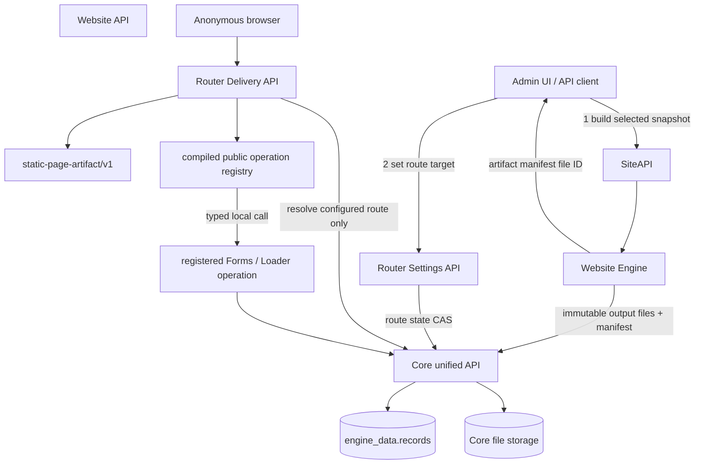
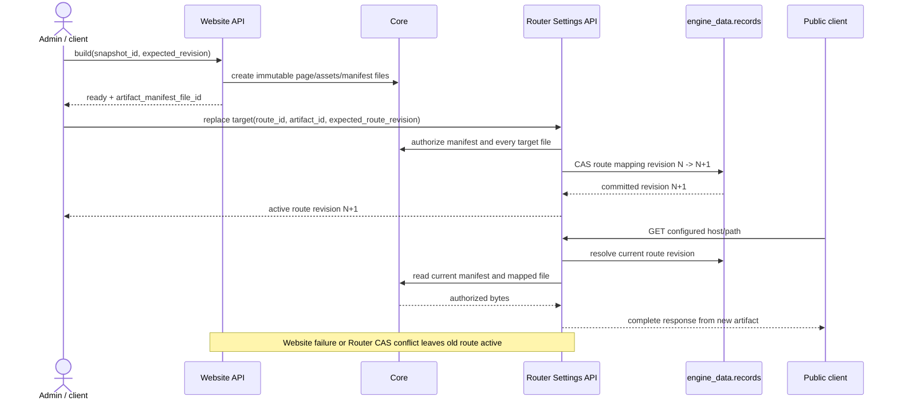

# Router Engine — целевая спецификация

Статус: согласованный контракт Router v2; код и acceptance-проверки остаются предметом отложенной итоговой проверки. Website snapshots задают одну страницу и не содержат URL; Website prerender создаёт immutable `static-page-artifact/v1`, а Router route явно задаёт `default_locale` и complete locale-to-manifest map. Router не хранит `snapshot_id`, `page_id`, feature manifests, dependency locks или Content revisions; API принимает только готовые artifacts. Route targets также могут быть Core file или зарегистрированной публичной operation. Operations доступны только если входят в скомпилированный профиль и зарегистрированы типизированным контрактом; произвольные callbacks и URL запрещены. `core-file` и registered operations используют exact path; artifact route связывает exact document path и его route-scoped assets. Router подключает отдельно настроенные Forms/Loader routes без прямого доступа к хранилищу. Загрузка закрыта по умолчанию и становится анонимной только для явно включённого маршрута. Загруженный Core file всегда остаётся приватным; публичная выдача требует отдельного явно настроенного GET route. Публичный `core-file` GET route связывается ровно с одним `file_id` из сохранённой конфигурации; посетитель не передаёт ID и не выбирает файл через FileSet. Router не реализует request-rate limiting. Публичный listener держится за внешним proxy, выбор которого и admission policy принадлежат deployer. Внутренние лимиты in-flight, per-route admission и fail-fast `503` при перегрузке описаны в [SPEC-concurrency.md](../../architecture/SPEC-concurrency.md). Coordinator может автоматически переключать file/artifact route после успешной публикации; public operation routes не меняются. Cache по умолчанию `no-store`; fallback неявно не применяется. Полная HTTP-политика, allowlist `Cache-Control`, `Vary`, сжатие и прогрев определяются [SPEC-caching.md](../../architecture/SPEC-caching.md). Общие правила Core и изоляции engine data: [SPEC-core-architecture.md](../../core/SPEC-core-architecture.md), [SPEC-module-data.md](../../core/SPEC-module-data.md); page artifact: [SPEC-static-site-artifact.md](../website/SPEC-static-site-artifact.md); Website: [SPEC-website-engine.md](../website/SPEC-website-engine.md).

Router не зависит от Website и не понимает snapshots или версии фич. Router обслуживает один публичный listener на логическую систему. Публичный listener следует держать за внешним proxy; Router сам не ограничивает частоту запросов, а выбор и настройка proxy относятся к развёртыванию. Внутренние in-flight лимиты и fail-fast `503` описаны в [SPEC-concurrency.md](../../architecture/SPEC-concurrency.md). Внешний caching proxy/CDN также принадлежит deployer и обязан сохранять `no-store`, ETag и `Vary` origin из [SPEC-caching.md](../../architecture/SPEC-caching.md). Router сопоставляет настроенные host и path с общим файлом, нейтральным static-page artifact или абстрактной зарегистрированной public operation. Он не реализует бизнес-правила Content/Forms и не вызывает движки по сети: operation предоставляется статическим composition root как типизированная Go capability.

`profiles/router.yaml` собирает самостоятельный production профиль Core + Loader + Router с File, Identity, Coordinator и Router Admin API, публичным Router listener и `public.form-upload`. Он не выбирает Website, Content, Forms или development fixtures: в этом профиле доступна только независимая Loader-загрузка. Form-bound upload и `public.form-session`/`public.form-submit` собираются только при явном выборе Forms и соответствующих public operations. Профиль собирается `make build-router` и проверяется `make test-router`; адрес listener задаётся оператором в Router-конфигурации. Профиль не устанавливает, не выбирает и не настраивает внешний proxy, включая caching proxy/CDN из [SPEC-caching.md](../../architecture/SPEC-caching.md).

## 1. Ответственности и API

Router является отдельным engine module и предоставляет два раздельных внешних контракта:

1. **Settings API** — авторизованное управление соответствием host/path и цели file, artifact или зарегистрированной operation, проверка конфликтов, чтение revision и атомарное переключение.
2. **Delivery API** — публичная выдача только по заранее сохранённым mappings. Route может вызвать лишь operation из неизменяемого каталога текущей сборки. В URL нельзя передать произвольный Core file ID, module-data key, operation name или параметры назначения загрузки.

Админский клиент сначала вызывает Website API и получает `artifact_manifest_file_id`; затем отдельным запросом вызывает Router Settings API. Нет Website→Router или Router→Website вызовов.

Settings API предоставляет `GET /api/admin/router/operations`: он требует ту же аутентификацию, что и настройки маршрутов, и возвращает только отсортированные неизменяемые descriptors операций, скомпилированных в текущий build profile (`id`, версия контракта, методы, предел тела запроса и MIME allowlist). Endpoint не раскрывает callbacks, route config, Loader credentials или содержимое файлов. Admin использует descriptor `public.form-upload` для построения допустимых настроек: только при наличии `POST`, `max_bytes` не выше `max_request_bytes`, выбранные MIME-типы должны быть подмножеством allowlist. Если каталог недоступен или операция не зарегистрирована, создание upload route закрыто; обычные file/artifact routes остаются доступны.

Префикс `/api/admin/` зарезервирован целиком и никогда не попадает в публичный Delivery catch-all, даже если для запроса используется неподдерживаемый HTTP-метод или percent-encoded path; неизвестный путь под этим префиксом возвращает `404`.

## 2. Независимость от Website snapshots

Router не хранит `snapshot_id`, `page_id`, Website build inputs или Website status. Для Router target — immutable Core file ID одного файла, manifest ID одного `static-page-artifact/v1` либо registered operation ID из текущего build profile. Operation route ссылается на скомпилированный ID; visitor не выбирает operation.

Оператор задаёт один `public_listen_address`, разрешённые публичные hosts и CORS/indexing policy при запуске. Маршрут определяется каноническими host и path. Целевой профиль запускается на чистой PostgreSQL после применения Core migrations. Router routes, publication и retirement используют системную область хранения. Совместимость с прежними неконтрактными ключами и заданиями, разделявшими область маршрутов, не входит в контракт. Приложение не очищает существующую PostgreSQL при старте.

Route → page publication slot связь принадлежит trusted outer Presentation/Coordinator registry, а не Website snapshot и не visitor request. Route record хранит текущую locale-to-artifact map и revision; привязка в registry непрозрачная для Router. После Website build и проверки готового page artifact coordinator вызывает Router ReplaceLocaleTarget для одной locale отдельным CAS. Сбой build или CAS оставляет прежнюю цель этой locale. Несколько routes/locales обновляются независимо; orchestration сообщает partial result и безопасно повторяет незавершённые назначения. System-wide Content publication автоматически триггерит этот fan-out через Coordinator, не заставляя Router разбирать Website или Content модель.

## Locale resolution и preference cookie

Каждый `static-page-artifact` route содержит ровно один проверенный artifact target для каждой locale из настроенного locale catalog и `default_locale` из того же catalog. Locale не входит в публичный route path и не выбирается visitor query-параметром. Для каждого request Router выбирает locale в фиксированном порядке:

1. `zubrium_locale` cookie, только если её значение является поддерживаемой locale именно текущего route;
2. `Accept-Language`: парсинг по HTTP quality values, сортировка по убыванию `q` с сохранением порядка заголовка при равенстве, затем RFC 4647 Lookup по поддерживаемым locale; `*` выбирает `default_locale`;
3. `default_locale`.

Неизвестное или некорректное cookie значение игнорируется; если ни один язык заголовка не сопоставлен, используется default. Другая locale никогда не подставляется поверх запрошенной. Locale preference cookie принадлежит Router Presentation: явная registered operation `public.locale-preference` на `POST /api/locale-preference` принимает только `locale` и same-origin относительный `return_path`, проверяет locale по route, куда ведёт этот path, устанавливает host-only `zubrium_locale` с `Path=/`, `HttpOnly`, `SameSite=Lax`, без `Domain`, `Secure` из обязательной startup-конфигурации и настроенным положительным `Max-Age`, затем отвечает `303` на тот же path. Нет автоматического срока по умолчанию; некорректный/внешний return path или неподдерживаемая locale отклоняются без установки cookie. Эта operation не меняет Content/Router mappings.

Website snapshots никогда не передаются Delivery API и не разрешаются динамически на запросе. Так Router остаётся заменяемым и не связывает публичную раздачу с внутренней моделью Website.

## 3. Постоянная конфигурация

Route mappings хранятся Router в namespace `router` таблицы `engine_data.records`, TTL `0`. Router владеет JSON payload и его версией; Core владеет физическим хранением и CAS. Локальный cache конфигурации допустим только как bounded производный cache с проверкой revision/invalidation и fail-closed поведением, согласованным с [SPEC-module-data.md](../../core/SPEC-module-data.md) и [SPEC-caching.md](../../architecture/SPEC-caching.md); цели прогрева и их лимиты задаются в `router.cache.*`.

Логическая запись маршрута включает:

- внутренний сгенерированный `route_id`;
- нормализованный host scope (только из разрешённой конфигурации);
- канонический path/prefix и тип matching;
- `target`: `core-file | static-page-artifact | registered-operation`; static artifact target содержит `default_locale` и упорядоченный список `{locale, artifact_manifest_file_id}` — по одному готовому manifest на каждую locale catalog; Router проверяет полноту и соответствие locale catalog до активации;
- `target.operation_id` и версия контракта — только для operation из build profile;
- `target.config` — типизированная конфигурация operation. Для upload route она задаёт destination access group и optional FileSet, максимальный размер и точный MIME allowlist; запрос содержит ровно один raw file body. Loader session expiry и multipart part limits задаются явно в startup config Loader, а staging concurrency/budget — в Router operation deployment config. Конфигурация никогда не берётся из visitor URL/body. Она включает анонимную загрузку только при явном включении route; Core file всегда остаётся приватным. Публичный `core-file` GET route привязывается к одному настроенному `file_id`, требует exact match и не читает ID или FileSet из запроса;
- ожидаемую revision для CAS и audit metadata без секретов;
- только разрешённые cache/security-header policies из [SPEC-caching.md](../../architecture/SPEC-caching.md);
- состояние `active` (чернового неявно публичного route нет).

Route records могут храниться отдельными CAS-документами. Каждая операция изменяет ровно один route; общей транзакции набора routes нет. Хранилище должно позволять детерминированно обнаруживать конфликты host/path до сохранения. TTL не используется.

### 3.1 Права на настройку

Settings API требует аутентификацию. Управление маршрутами ограничивается выделенной статической access group, например `router_routes`: уровень `1` даёт чтение конфигурации, уровень `2` — создание, изменение, переключение и удаление route. Эту группу может объявить startup YAML либо зарегистрировать Router при запуске; одинаковое глобально уникальное имя в обоих источниках обозначает одну группу. Отсутствие группы среди всех источников или назначения означает отказ. Неявное право только из-за слова «admin» не возникает.

Router runtime использует отдельную обычную Core user identity с минимальными read grants для целевых файлов и artifact assets. Delivery API не получает обход авторизации Core. Если доступ runtime principal отозван, выдача закрывается при актуальной проверке Core. Возможный кэш прав `core.authorization` является подсказкой с проверкой `revision + access_epoch` и не меняет эту гарантию; его правила описаны в [SPEC-caching.md](../../architecture/SPEC-caching.md).

Обновление route не может увеличить Core grants. Установка file/artifact цели должна проверить, что Router identity имеет возможность прочитать файл/manifest и его допустимые dependencies. Для operation target проверяются наличие operation в каталоге сборки и соответствие конфигурации её схеме. Публичная загрузка дополнительно требует текущий уровень `2` у Router service identity в настроенной группе загрузки и в `management_group` указанного FileSet. Эта проверка выполняется при создании/замене route и перед staging каждого запроса; Loader повторно проверяет права в момент записи. Отсутствующая или недоступная группа/FileSet закрывает операцию. Если API не может безопасно проверить необходимые права или ограничения, target не активируется. Кэширование решения о правах допускается только с fail-closed валидацией из [SPEC-caching.md](../../architecture/SPEC-caching.md).

## 4. Settings API

Методы API ниже — семантический контракт, а не обязательные имена URL:

- `ListRoutes(filter)` — только с уровнем чтения конфигурационной группы;
- `GetRoute(route_id)` — вернуть mapping и revision, не раскрывая недоступные Core objects;
- `CreateRoute(route_spec, idempotency_key)` — проверить host/path/target, конфликт, Core grants или регистрацию/schema operation;
- `ReplaceTarget(route_id, new_target, expected_revision)` — атомарный CAS target binding;
- `UpdatePolicy(route_id, policy, expected_revision)` — изменить только allowlisted serving/cache policy из [SPEC-caching.md](../../architecture/SPEC-caching.md);
- `DeleteRoute(route_id, expected_revision)` — удалить mapping через явную аутентифицированную операцию.

Клиент получает `409 Conflict` на stale revision/route collision, контролируемую validation error на невалидный target и authorization error на недостаточный Core grant. Ошибка до CAS не меняет активный mapping. Повтор с тем же idempotency key и fingerprint возвращает исходный результат; другое тело с тем же ключом — конфликт.

Настроечное изменение сначала полностью валидируется и подготавливается, затем одной CAS операцией переключает route record/revision. Успешный ответ возвращается только после долговременной записи в Core module data. Инвалидация кеша другим процессам инициируется после commit; при недоступности инвалидации инстансы проверяют актуальную revision, а при невозможности проверки закрывают выдачу. Старое значение не используется как fail-open. Ограничения `router.manifests` и `router.routes`, их TTL и метрики описаны в [SPEC-caching.md](../../architecture/SPEC-caching.md).

## 5. Delivery API

Запрос публично отдается, только если host + path разрешились в активный route. Core files остаются приватными; публичный доступ возникает только в результате явного route binding. Передача ID файла клиентом не может создать route или получить доступ.

### 5.1 Matching и нормализация

- Route host сопоставляется со стандартным HTTP Host запроса; forwarded-заголовки не участвуют в выборе route. Сконфигурированный host — каноническое имя без порта; допустимый числовой порт во входящем `Host` снимается перед поиском route, а неоднозначный или некорректный Host отклоняется. Запись host нормализуется (нижний регистр, необязательная завершающая точка) до использования в ключе маршрута. Exact-запись, чей путь является префиксом запроса, не прерывает поиск других подходящих маршрутов.
- Текущий публичный Router не ограничивает частоту запросов, в том числе по IP. Его listener нельзя выставлять напрямую в публичную сеть: deployer должен закрыть его за внешним proxy. Выбор, настройка и эксплуатация proxy, включая его admission policy, остаются ответственностью deployer и не входят в приложение или этот репозиторий.
- Path нормализуется ровно один раз: reject encoded separators/dot-segments, NUL и неоднозначную кодировку; привести percent encoding по единому алгоритму до matching.
- Route precedence фиксирован: exact match выше longest-prefix; равный конфликт запрещён до публикации. Не использовать порядок строк БД как порядок маршрутизации.
- Prefix target вычисляет только относительный путь внутри artifact manifest. `..`, абсолютный путь и неразрешённая запись manifest отвергаются.
- Никаких динамических callbacks, reverse proxy к произвольному адресу, произвольного Go handler или прямого пути к S3. Нельзя исполнить operation, отсутствующую в каталоге текущего build profile. Для зарегистрированной operation Router передаёт только нормализованный HTTP request envelope и сохранённую server-side route config; операция сама проверяет метод/схему и выполняет предметную авторизацию.

Каталог public operations собирается из статических импортов выбранного build profile и проверяет уникальность ID при запуске. Контракт operation объявляет версию, разрешённые HTTP-методы, точные допустимые media types и максимальный размер тела. Перед dispatch Router повторно валидирует сохранённый target/config, метод, тип содержимого, idempotency key и размер; повторяющиеся `Content-Type` или `Idempotency-Key` отклоняются как неоднозначный запрос. Превышение объявленного лимита возвращает `413`; chunked/неизвестное тело остаётся потоком через ограниченный reader. Upload operation должна дочитать поток до EOF и проверить все ошибки чтения до commit. Cookie и произвольные HTTP-заголовки не передаются в Engine; Router Presentation валидирует form-session cookies и преобразует только токены для ID формы из сохранённой route config в типизированный `FormSessionTokens` envelope.

Для `core-file` Router обслуживает только GET/HEAD и отдаёт ровно настроенный файл только при exact path match. Новая загрузка не становится публичной автоматически: для её `file_id` оператор отдельно создаёт GET route. FileSet не является механизмом публичного поиска/выдачи. Для `static-page-artifact` Router выбирает одну locale по locale resolution contract и выдаёт ровно `document` соответствующего manifest; asset request разрешается только внутри `assets` выбранного artifact. Locale нельзя переопределить path/query. Неизвестный asset path возвращает 404. `registered-operation` вызывает только локальную типизированную capability, зарегистрированную при старте; неизвестная operation возвращает контролируемую ошибку без fallback. Website artifact не содержит entrypoints или fallback; отдельная route policy fallback к документу не предусматривается.

Анонимная загрузка выполняется только через явно включённую зарегистрированную operation `public.form-upload`. Для независимой загрузки нужны Router и Loader; Forms не обязателен. Конфигурация route задаёт `enabled: true`, существующую access group, лимит байтов и непустой список допустимых MIME types; FileSet необязателен. Form-bound route дополнительно фиксирует глобальный `form_id` и `schema_version`, требует FileSet и Forms capability; `snapshot_id` в конфигурации форм больше не существует. Запрос содержит один raw file body и `field=<field_id>`; посетитель не задаёт destination и получает доступ только через cookie сессии формы. Перед сохранением route Forms проверяет действующую схему, а операция проверяет конкретное поле, права, MIME и лимиты при upload.

Загрузка сначала проверяет настроенную серверную Loader-учётную запись, затем регистрирует тело запроса как scoped stream и через typed DataBus operation передаёт его Loader. Router Presentation не работает с файловой системой: байты, размер и SHA-256 обрабатывает Loader через Core staging capability, а Router лишь ограничивает поток до EOF и проверяет ошибки чтения до commit. Серверная конфигурация задаёт максимальное число одновременно staging-запросов и общий байтовый бюджет; произведение числа слотов на максимальный размер файла не может превысить этот бюджет. Публичный listener должен быть скрыт за внешним proxy; Router сам не ограничивает частоту запросов, а выбор и настройка proxy остаются ответственностью deployer.

Operation генерирует имя файла и стабильный Loader idempotency key из route scope и обязательного visitor `Idempotency-Key`; переданные посетителем group, FileSet ID, file ID и имя не используются. При повторе с тем же ключом и теми же байтами Loader безопасно продолжает части и commit; другой файл под тем же ключом приводит к отказу. Loader повторно проверяет размер, checksum и актуальный уровень доступа `2` к upload group. При настроенном FileSet operation добавляет готовый файл в этот набор с revision retry; сбой индекса возвращает временную ошибку, а повторный запрос завершает добавление без второй копии файла. Из-за возможного сбоя между S3 commit и FileSet membership уже сохранённый файл остаётся приватным в access group и может быть доиндексирован идемпотентным повтором.

Upload принимает один raw file body на запрос; multipart parsing не является частью Router. Allowed MIME types задаются явно и сверяются по базовому media type; активные browser types (`text/html`, JavaScript, SVG, XML, CSS и т. п.) запрещены для этой operation. Файловые байты никогда не проходят через Core напрямую из Router: весь lifecycle выполняет Loader. Core file остаётся приватным; анонимная выдача включается отдельно настроенным GET route. Публичный listener должен быть скрыт за внешним proxy. Router сам не ограничивает частоту запросов; выбор и настройка proxy относятся к deployment и не реализуются приложением.

### 5.2 Forms visitor routes и cookie transport

Публичный form flow состоит из трёх route config, каждый со своим exact path и server-side binding на одну форму и версию схемы:

1. `public.form-session`: `POST` создаёт сессию или возвращает активную из cookie, `GET` читает текущую сессию, `DELETE` отменяет незавершённую и очищает cookie.
2. `public.form-upload`: `POST` принимает raw файл; query содержит только `field`, а сессия приходит из cookie. Цели и лимиты берутся из route config; загрузка проходит через Loader.
3. `public.form-submit`: `POST` принимает JSON `{ "values": { ... } }` и обязательный `Idempotency-Key`; успешная отправка возвращает квитанцию и сохраняет cookie для безопасного повтора после потерянного ответа.

Router ставит host-only cookie с `Path=/`, без `Domain`, `HttpOnly`, `SameSite=Strict`, временем жизни сессии и явно настроенным `Secure`. Для `Secure=true` имя `__Host-zubrium-form-<form_id>`, для development `Secure=false` — `zubrium_form_<form_id>`. Token не возвращается в JSON, URL или логи. Router не принимает `form_id`, schema version, access group, FileSet или Core file ID от посетителя. Отсутствующий/невалидный/истёкший capability не раскрывает существование закрытых ресурсов. Ответы используют `no-store`; `DELETE` очищает cookie, а создание новой сессии заменяет её. Подробности session state, field types и валидации определяет [SPEC-forms-engine.md](../forms/SPEC-forms-engine.md).

Для публичной загрузки нет IP rate limiter в приложении; внешний proxy перед listener обязателен при публичной экспозиции. Настройка gateway/proxy, лимитов IP, admission policy и caching policy — обязанность deployer, а не Router; caching proxy не должен кэшировать `no-store`-ответы и должен учитывать `Vary` согласно [SPEC-caching.md](../../architecture/SPEC-caching.md). Server-side in-flight admission и его метрики подчиняются [SPEC-concurrency.md](../../architecture/SPEC-concurrency.md).

### 5.3 HTTP-ответ и безопасность

- `Content-Type` берётся из проверенного allowlisted значения/manifest, а не из произвольного запроса; применяются безопасный charset и `X-Content-Type-Options: nosniff`.
- Content-Disposition для `core-file` target управляется серверным полем `target.disposition` (`inline` или `attachment`) и не принимается от посетителя. Без поля значение `inline` применяется только к разрешённым web types (`image/jpeg`, `image/png`, `image/webp`, `image/avif`, `image/gif`, `video/mp4`, `video/webm`, `audio/mpeg`, `application/pdf`); иные типы, включая HTML и SVG, всегда скачиваются как attachment. Явное `attachment` перекрывает безопасный MIME.
- ETag строится из checksum immutable file/manifest; conditional GET проверяется после разрешения route и актуальной Core авторизации. Validators, weak comparison и 304 подчиняются [SPEC-caching.md](../../architecture/SPEC-caching.md).
- Range поддерживается только если Core streaming contract его безопасно реализует; в противном случае route отвечает без Range, не буферизуя неограниченный файл в памяти.
- Cache-Control по умолчанию — `no-store`. Допустимы только `no-store` и `public, max-age=<uint>[, immutable]` из allowlist [SPEC-caching.md](../../architecture/SPEC-caching.md) при `<uint> > 0`; приватные данные и authorization responses не попадают в shared CDN cache. Locale из cookie остаётся `no-store`, locale из `Accept-Language` получает `Vary: Accept-Language`; сжатие добавляет `Vary: Accept-Encoding`.
- CORS и indexing headers задаются startup policy и route allowlist; значения из файла или запроса не могут установить произвольный origin/header.
- Внутренние Core IDs, ошибки S3, права, namespace и наличие закрытых файлов не раскрываются в публичном теле ответа.
- Ошибка Core/module-data проверки закрывает доступ. Недоступный объект не может быть доставлен из устаревшего Core byte cache, кэша прав, manifest cache или route cache.

## 6. Атомарная публикация маршрута

Website сначала создаёт и проверяет immutable artifact для конкретной locale. Router при настройке проверяет каждый manifest и необходимые файлы для всех locales из catalog. Затем locale target одного route переключается одной CAS revision; запросы разрешают либо старый, либо новый complete artifact для выбранной locale. Публикация несколькими locale или routes выполняется независимыми CAS и может иметь частичный результат.

Atomicity распространяется на один route binding. Если UI переключает несколько независимых routes, она должна использовать bulk CAS/route-set revision или явно показывать частичное применение; последовательность отдельных update не объявляется атомарной.

Старый artifact после успешного switch остаётся доступным, пока Website не удалит его по собственным ссылкам и политикам retention. Router не удаляет файлы при смене target. Core не имеет глобального реестра engine references.

## 7. Сбои и наблюдаемость

- Не настроенный route возвращает обычный 404 без попытки угадывать Core ID.
- Конфликт route предотвращается при записи и повторно проверяется при загрузке state; повреждённая конфигурация закрывает конфликтующие mappings.
- Недоступность Core или module data не должна переводить route в произвольную выдачу/старый target без проверки актуальности.
- Ошибка загрузки одного artifact file возвращает контролируемую 5xx/404 политику без утечки внутренней детали; частично собранная HTML-страница не маркируется успешной.
- Метрики: route resolution hit/miss, Core authorization failures, revision conflicts, artifact-manifest errors, bytes streamed, request latency и invalidation lag. Метрики кэшей и прогрева перечислены в [SPEC-caching.md](../../architecture/SPEC-caching.md) и не содержат file ID, URL, locale или principal ID. Логи не включают содержимое файлов, credentials и секреты.

## 8. Приёмочные проверки

Нужны unit/contract/integration и реальный HTTP/browser acceptance для:

1. явной публикации файла и запрета прямого доступа к тому же UUID вне route;
2. route на `static-page-artifact/v1`, exact document path, route-scoped asset mapping, query string и неизвестный asset path;
3. одного публичного listener, разделения hosts, единого глобального scope и отсутствия неконтрактных полей в HTTP-контракте;
4. exact/longest-prefix matching, конфликта на одном host и одинакового prefix на разных hosts;
5. percent-encoded traversal/separators, malformed URL, spoofed Host/Forwarded headers;
6. access revocation, отсутствующей группы, stale local cache, отказа проверки revision, а также сценарии `CACHE-004` и `CACHE-006` из [SPEC-caching.md](../../architecture/SPEC-caching.md);
7. параллельных replaceTarget с одинаковой expected revision: только один commit succeeds;
8. недоступного/частичного artifact, checksum/content-type mismatch и отказа до переключения;
9. старого route при Website build failure и CAS conflict;
10. cache headers, allowlist `Cache-Control`, ETag/conditional GET, `Vary` для locale и сжатия, Range policy, CORS/indexing, безопасных response headers и метрик кэша из [SPEC-caching.md](../../architecture/SPEC-caching.md);
11. невозможности Router→Website RPC, вызова не зарегистрированной operation, произвольного handler/URL/Core UUID/group/FileSet/visibility в visitor request;
12. хранения route records только через Router-scoped Core module-data API;
13. form-session cookie lifecycle, фиксированного schema binding, exact-only public operation routes, submit idempotency, upload через Loader, MIME/size/group/FileSet policy, schema change и cleanup cancellation.

Browser QA не отправляет writes в общий или production API. Используется уникальная изолированная конфигурация и disposable данные.

## 9. Зафиксированные решения

1. CAS и атомарность применяются к одной записи route. Последовательное обновление набора может завершиться частично и должно отображать это состояние клиенту.
2. Cache-Control по умолчанию — `no-store`; `public, max-age=<uint>, immutable` задаётся только явной настройкой и CAS-валидацией согласно [SPEC-caching.md](../../architecture/SPEC-caching.md).
3. Неизвестный asset path текущего artifact возвращает 404; artifact не задаёт route fallback или SPA fallback.
4. Router вызывает только зарегистрированные в сборке public operations; route config может ссылаться на operation ID из этого каталога, но не задаёт произвольный callback/URL. Публичная загрузка допускается только через явно настроенную operation и проходит через Loader.
