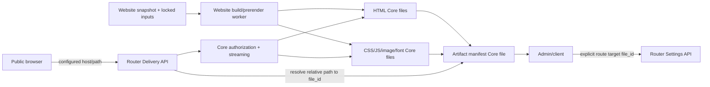

# Static Page Artifact v1 — нейтральный формат сборки

> **Target:** Website page snapshot производит один prerendered HTML document и его immutable assets. Snapshot и artifact не содержат публичный URL; Router route указывает на manifest ID готового артефакта. Coordinator/Presentation переключает route после успешной проверки, не вызывая Router из Website.

Статус: целевой engine-neutral контракт для одной страницы. Он позволяет Website передать завершённую страницу независимому Router без вызова Router из Website. Router знает только manifest `static-page-artifact/v1` и Core file IDs; он не интерпретирует page snapshots, feature manifests, dependencies или Content.

Основной сценарий и сборка описаны в [SPEC-website-engine.md](SPEC-website-engine.md); назначение публичного route — в [SPEC-router-engine.md](../router/SPEC-router-engine.md).

## 1. Цели и ограничения

- Артефакт полностью immutable после готового состояния.
- Содержимое каждой страницы и каждого ресурса хранится как отдельный Core file.
- Единственный входной объект — Core file, содержащий manifest `static-page-artifact/v1`.
- Manifest описывает один HTML document и набор его immutable assets по artifact-relative paths, Core file IDs, проверенным типам содержимого, checksum и размеру.
- Артефакт не даёт прав и не делает Core files публичными; прочитать их может только авторизованная identity Router.
- Manifest не содержит snapshot/feature/branch/route semantics и не может указать публичный URL, S3 key, путь локального диска или произвольный redirect.
- Создание/проверка артефакта полностью завершается до его привязки к публичному маршруту.



## 2. Manifest schema

Рекомендуемая сериализованная форма:

```json
{
  "format": "static-page-artifact/v1",
  "digest": "sha256:<digest-of-canonical-payload>",
  "document": {
    "file_id": "<core-uuid>",
    "content_type": "text/html; charset=utf-8",
    "sha256": "<hex-digest>",
    "size": 1234
  },
  "assets": {
    "assets/app.abc123.js": {
      "file_id": "<core-uuid>",
      "content_type": "text/javascript; charset=utf-8",
      "sha256": "<hex-digest>",
      "size": 5678,
      "cache_class": "immutable"
    }
  }
}
```

Это логическая схема; точный JSON Schema/versioned Go contract фиксируется при реализации. `digest` рассчитывается однозначно по canonical payload без самого поля digest. `document` — ровно один HTML document; `assets` содержит только его ресурсы и не задаёт страницы или маршруты. Пути assets — канонические относительные пути без начального `/`; HTML использует соответствующие относительные URL. Router связывает один route непосредственно с artifact manifest: запрос по точному route возвращает `document`, а разрешение asset path происходит только в пределах этого же artifact. Для artifact с assets используется prefix route; exact route может обслуживать только artifact без assets, поскольку он не образует пространства путей для ресурсов. `cache_class` ограничен enum `none|short|immutable`; Router отображает его на безопасную HTTP cache policy из [SPEC-caching.md](../../architecture/SPEC-caching.md): `no-store`, `public, max-age=<uint>` или `public, max-age=<uint>, immutable`.

Все ID генерирует Core. Поле `file_id` — UUID, проверяемый Core. Каждый файл manifest должен быть включён в один и тот же готовый artifact. Записи файлов нельзя переопределять запросом и нельзя резолвить по файловому имени на S3.

## 3. Правила путей и содержимого

- Artifact-relative asset path каноничен, нормализован в UTF-8 и не начинается с `/`; это URL-relative path, а не путь ОС.
- Запрещены `.`/`..`, двойное неоднозначное декодирование, NUL, backslash, encoded separator и абсолютный URL.
- Слеши/percent encoding обрабатываются единообразно; дубли после нормализации запрещены.
- Manifest не содержит публичных routes, внешних redirect targets, произвольных response headers, template expressions, S3 URI и route registration commands.
- `content_type` выбирается из server-side allowlist и проверяется по реальным байтам/назначению: `text/html`, `text/css`, `text/javascript`, `application/javascript`, `application/json`, `image/jpeg`, `image/png`, `image/webp`, `image/avif`, `image/gif`, `font/woff`, `font/woff2`, `application/font-woff`; `charset=utf-8` допускается только для HTML/CSS/JavaScript. Для неизвестного типа Router использует attachment/nosniff или отклоняет artifact по политике.
- Checksum и `size` проверяются при упаковке; Router обязан сверять актуальные метаданные Core и revision при публикации и при каждом использовании кэшированного manifest, как описано в [SPEC-caching.md](../../architecture/SPEC-caching.md).
- Один файл не становится публичным от присутствия в artifact. Доступ существует лишь через активный Router mapping и Router Core identity.
- Один и тот же Core file ID может быть использован в нескольких asset paths только при явном разрешении и совпадении metadata; по умолчанию дублирующие пути считают ошибкой build.

Router route имеет собственный точный path и binding на один artifact. Document выдаётся для точного совпадения route; asset requests разрешаются только к `assets` этого же artifact по безопасному route-scoped правилу. Query string не меняет mapping, если отдельный будущий контракт явно не добавит query routing.

## 4. Построение, проверка и жизненный цикл

Website создаёт страницы и ресурсы как Core files, собирает manifest последним, проверяет все ссылки и получает immutable Core file ID manifest. В build record сохраняются digest входов, manifest ID и результат проверки. Manifest artifact не может быть активирован, пока:

1. `document` и все asset file IDs существуют и читаются Website build identity;
2. asset paths каноничны и уникальны;
3. document имеет допустимый HTML content type, все упомянутые локальные assets существуют, а непредусмотренные локальные ссылки/страницы не включены;
4. checksum и размеры сходятся с Core metadata;
5. допустимы content types и лимиты количества/общего размера;
6. HTML/assets соответствуют runtime output policy;
7. Router runtime identity имеет актуальные read grants на document и assets для предполагаемого route.

Проверка Router не создаёт зависимости на Website. Из artifact manifest нельзя получить Website snapshot ID и по нему запросить дополнительные данные.

Artifact ID — Core file ID manifest. Успешное создание artifact не активирует публичный доступ. Клиент задаёт/обновляет Router binding отдельным вызовом. Смена route не удаляет старый artifact и его файлы. Очистку завершённых неиспользуемых сборок выполняет Website согласно своему сроку хранения и собственным ссылкам; Core не поддерживает глобальный reference registry.

## 5. Выдача

При запросе Router:

1. определяет статический branch scope и находит точный активный route binding;
2. подтверждает свежую revision route state и права своего Core principal;
3. читает artifact manifest через Core и проверяет поддерживаемый `format`/schema;
4. для точного route запрашивает `document`; для route-scoped asset request канонизирует относительный asset path;
5. находит только точный asset entry в `assets` текущего artifact;
6. читает соответствующий Core file потоком;
7. применяет только безопасные headers/cache policy из [SPEC-caching.md](../../architecture/SPEC-caching.md) и возвращает байты.

При неизвестной версии формата Router не пытается угадать поля и не отдаёт содержимое. Отсутствующий target file не раскрывает внутренний UUID. Устаревший manifest/route cache не используется, если актуальность и авторизация не подтверждены; границы, TTL, метрики и прогрев таких кэшей описаны в [SPEC-caching.md](../../architecture/SPEC-caching.md).

## 6. Проверки совместимости

Контракт фиксируется тестовыми fixtures: минимальный single-document page artifact, versioned assets, пустой/слишком большой manifest, дубли нормализованных asset paths, неизвестная версия, отсутствующий Core file, неверный digest, запрещённый MIME, revoked access и инвалидация по CAS/revision из [SPEC-caching.md](../../architecture/SPEC-caching.md). Fixtures являются данными для проверки, не живыми публичными файлами.

Проверка реализации должна подтвердить, что Website может собрать artifact без Router; Router может раздать artifact без знания Website; Core access revocation сразу закрывает выдачу; и route switch на новый artifact сохраняет прежнюю выдачу при любой ошибке до успешного CAS.
