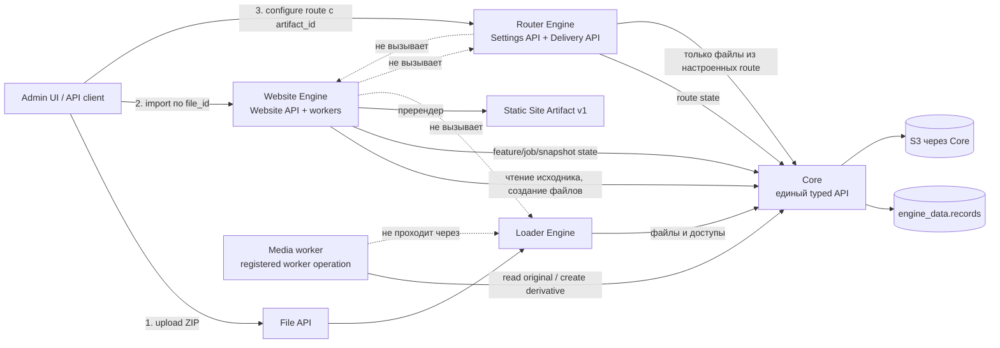

# Website Engine — целевая спецификация


Статус: согласованная целевая спецификация независимого Website Engine; реализация приложения и HTTP API не завершена. Этот документ описывает целевой контракт, а не подтверждённые возможности текущей сборки. Для общих правил Core и хранения engine-данных применяются [SPEC-core-architecture.md](../../core/SPEC-core-architecture.md) и [SPEC-module-data.md](../../core/SPEC-module-data.md). Нейтральный формат результата статической сборки описан в [SPEC-static-site-artifact.md](SPEC-static-site-artifact.md), публичная маршрутизация — в [SPEC-router-engine.md](../router/SPEC-router-engine.md), границы внешних адаптеров — в [SPEC-engine-apis.md](../../architecture/SPEC-engine-apis.md). Целевой runtime поддерживает только новый ABI с lifecycle `render / hydrate / update / dispose`; ZIP Vitasil адаптируются до импорта. Runtime contract описан в [SPEC-feature-runtime.md](features/SPEC-feature-runtime.md).

Эта спецификация запрещает прямые зависимости Website от Loader, Router и других движков. Согласованная target-модель отделяет системные данные, страницу, её версии и публичный URL: системные данные общие для всех страниц одной логической системы, у каждой страницы — независимое дерево снапшотов, а URL существует только в Router. Website возвращает готовый page artifact; внешняя Presentation/Coordinator оркестрация связывает его с Router route, не передавая Router `snapshot_id`.

### Target Website API: страницы и их версии

Website работает в одной логической системе без дополнительных уровней изоляции; страницы создаются и управляются через Website API. Website генерирует стабильный `page_id` при создании страницы; клиент не может задавать или переиспользовать этот ID. Snapshot идентифицируется `page_id`; каждый snapshot содержит ровно одну страницу. Parent и child обязаны принадлежать одному `page_id`, а страницы образуют независимые деревья. Конфигурация страницы включает её имя, page-scoped SEO, placements, arguments, bindings и feature lock, но не URL, host, branch, route или route assignment. Страница не имеет route. Branch topology, path и привязка готового artifact принадлежат Router.

`POST /api/admin/pages` синхронно создаёт новую страницу и её готовый root snapshot в одной идемпотентной операции; можно передать `template_id` и точную `template_revision` либо создать пустую страницу. Website генерирует стабильный UUID `page_id`; успешный ответ возвращается только после долговечной фиксации страницы и snapshot в состоянии `ready`. При сбое операция не раскрывает частично созданную страницу, а повтор с тем же `Idempotency-Key` безопасно завершает или возвращает тот же результат. Каталог страниц системный; list/detail требуют уровень `1`, создание/изменение структуры — уровень `2` в настроенной Website-группе. `DELETE /api/admin/pages/{pageID}` начинает durable retirement workflow с `If-Match` и `Idempotency-Key`: связанная trusted orchestration выводит каждый зарегистрированный Router route из выдачи отдельной CAS-операцией. Страница не считается `retired`, пока все её route bindings не удалены; частичный результат остаётся `retiring` и безопасно повторяется. Retired page ID нельзя переиспользовать; page identity и snapshots сохраняются как история, Content records/publications/history остаются общими, Forms schemas/submissions и вложения не удаляются, а файлы очищаются только отдельной операцией после проверки ссылок.

`POST /api/admin/snapshots` создаёт child только для уже существующего `page_id`; root разрешён только как часть создания страницы. Клиент не может создавать или присваивать snapshot неизвестной странице. Создание immutable child проверяет revision ready-parent и durable workflow инициализирует новый page-scoped state; системные model/records не копируются. При обычном fork workflow сохраняет согласованные selections; при замене структуры шаблоном новый snapshot начинает с selections только для своих новых placements, а parent остаётся неизменным. Snapshot становится `ready` только после workflow finalization. Удаление snapshots проверяет защиту page tree и перепривязывает дочерние snapshots только внутри этого дерева.

Website сохраняет единственную системную запись `content-model` в `website/content-models` с payload version 1, CAS revision и digest; она не находится в namespace snapshot. `GET /api/admin/model` возвращает typed `ContentModel` (`version`, `model_revision`, `digest`, `data_model`), а `PUT` принимает новую модель с `expected_revision`; Website валидирует модель и блокирует schema update, если существующие page bindings станут невалидными. `GET /api/admin/pages/{pageID}/snapshots/{snapshotID}/content-projection` возвращает typed `PagePlacementProjection`, revision/digest которого независимы от системной модели; запрос проверяет точное совпадение `(page_id, snapshot_id)`.

Website DTOs не импортируют Content. Trusted outer Presentation читает эти два DTO, использует каждый placement's pinned `feature_key@version` для присоединения typed `dataInputs` из feature manifest и строит `content.Projections{ContentModel, Page}`; Content projection digest вычисляется после такого преобразования. Отдельный `PUT /model` принимает только исходный `data_model` и `expected_revision`; typed `ContentModel` и `PagePlacementProjection` формируются сервером и никогда не принимаются как request body. Content HTTP API не принимает модель или проекции клиента. `dataModel` запрещён в page snapshot config/payload. Website DTO сохраняет прямые page bindings (`entity_id`, `field_id`, `fields`, lookup и detail SEO); feature input kind берётся только из закреплённого manifest, не угадывается из binding shape.

`BranchAPI`, branch-to-snapshot assignments и assignment event history не относятся к Website и удаляются из его внешнего контракта. Router хранит явный route → ready page artifact binding. Для надёжной публикации внешняя orchestration регистрирует/находит затронутые route slots, строит locale-specific page artifacts для опубликованной locale и переключает каждую пару `(route, locale)` отдельным CAS. Locale catalog/default включаются в доверенный build input; для каждой route настроена locale-to-artifact map с одной целью на поддерживаемую locale. Сбой build/CAS оставляет прежнюю цель только у соответствующей пары; fan-out возвращает частичный результат и безопасно повторяется. Ни Website snapshot ID, ни locale не принимаются от visitor как target selection.

### Библиотека шаблонов страниц

Шаблон — изменяемая CAS-ревизиями запись Website в системном namespace `website/page-templates`; в первой версии доступны только пользовательские шаблоны. Он содержит `template_id`, name, description, revision, digest, `schema_version` и конфигурацию страницы: reusable page name, page-scoped SEO (title, description, Open Graph и robots-поля), placements в заданном порядке, точные feature versions/dependency lock, arguments и typed `dataBindings`. При создании страницы из шаблона обязательное `name` запроса задаёт имя новой страницы и переопределяет reusable page name из конфигурации. В шаблон не входят page ID, snapshot ID, route/path/host, branch assignment, canonical URL, system-wide `dataModel`, значения records, Content drafts/publications, media bytes или editorial selections. Для добавления фич используются только поддерживаемые Website/feature placement contracts; шаблон не вводит общие `header`/`footer`/`background` wrappers или новые lifecycle roots.

Отдельный редактор библиотеки создаёт шаблон с нуля, редактирует его и удаляет. Каждое изменение конфига требует `expected_revision` и создаёт следующую CAS revision/digest; предыдущие ревизии шаблона не обещаются как доступная история. Изменение или удаление шаблона никогда не меняет созданные страницы: при применении конфигурация материализуется в page snapshot, а пара `template_id`/`template_revision` сохраняется только как audit provenance, не как runtime-зависимость. В `engine_data.records` template хранится как Website-owned record с отдельным payload version; Core остаётся единственным persistence gateway. Листинг и чтение требуют Website level `1`; создание, редактирование, удаление и применение — level `2`.

`POST /api/admin/pages` может создать страницу из текущей ревизии шаблона. Для существующей страницы явное применение шаблона всегда создаёт child в её собственном snapshot tree; операция требует expected ready snapshot/revision, Content workspace revision и `Idempotency-Key`. Клиент показывает пользователю полный diff и требует подтверждения до отправки операции. Замена сохраняет `page_id`, но заменяет name, page-scoped SEO, placements, arguments и bindings; URL/Router routes, parent snapshot, другие page trees, system-wide model/records, draft/publication values не меняются. В новом snapshot удаляются selections старых placements и для новых placements создаётся начальное пустое selection state; пользователь предупреждается об этом до подтверждения. После применения публикация/build и явное назначение готового artifact в Router остаются отдельными действиями.

Website проверяет конфигурацию при создании/редактировании шаблона и повторно при применении: разрешает точные feature versions и dependency closure без автоматического повышения версий, валидирует arguments и bindings относительно pinned manifests и текущей системной модели, проверяет уникальность placement IDs и все лимиты snapshot. Отсутствующая версия или несовместимость `dataBindings` блокирует операцию без частичного создания страницы/snapshot; клиент получает стабильную machine-readable ошибку. `template_id` всегда проверяется в системном scope; недоступная чужая запись не раскрывает факт существования. Template API не принимает module identity, namespace, route, FileSet или произвольные Core IDs.

## 1. Назначение и границы


Website Engine управляет статическими фичами и страницами, построенными из этих фич. В его область входят:

- каталог и версии фич;
- асинхронный импорт ZIP-фич, загруженных ранее через File API;
- разрешение зависимостей и фиксация точных версий фич в снапшоте;
- системная модель структуры и настройки, принадлежащие Website;
- асинхронный prerender статических страниц;
- создание неизменяемого одностраничного artifact;
- асинхронная обработка медиа через отдельную worker capability;
- запись собственных состояний и метаданных через scoped API Core.

Website не владеет PostgreSQL, схемой БД, SQL, S3, файловыми байтами, протоколом загрузки, публичной маршрутизацией и сетевым API Router. Он не вызывает API других движков. Сборку запускают Admin API или внутренний worker Website; результат возвращается вызывающему клиенту как идентификатор статического артефакта. Клиент при необходимости отдельно передаёт этот идентификатор Router Engine.



Схема показывает три самостоятельных запроса клиента, а не цепочку синхронных вызовов между движками. Успешная загрузка через File API сама по себе не импортирует фичу и не публикует страницу.

## 2. Модульные границы

| Часть | Ответственность |
|---|---|
| File API + Loader | Приём байтов, загрузочные сессии и создание исходного Core-файла. Не распаковывает Website ZIP. |
| Website API | Импортирует фичу по существующему `file_id`, управляет каталогом, динамическими страницами, шаблонами, снапшотами и заданиями сборки. Клиент не выбирает FileSet. |
| Website workers | Website-owned workflow prepares inputs and verifies outputs; Archive/Media/Prerender worker operations run only when registered in the selected static profile. All file operations go through Core. |
| `worker.media` | Executes immutable media derivatives from the pinned feature manifest profile; it has no public preset-selection API. |
| Core | Единственный API доступа к файлам, правам, наборам и module data; единственный владелец PostgreSQL и S3. Не знает терминов «сайт», «фича», «снапшот», «пререндер» и «FFmpeg». |
| Router Settings API | Сохраняет явное соответствие публичного маршрута Core-файлу или статическому артефакту. Не знает, какой движок его создал. |
| Router Delivery API | Отдаёт только цели, опубликованные в конфигурации Router, используя авторизованную идентичность Core. |

Все внешние пользовательские API фич, страниц, файлов и маршрутов независимы. Общая админка может предоставить единый экран, но orchestration в ней — последовательность отдельных API-вызовов и не создаёт скрытой связи движков.

## 3. Данные Website

Вся долговременная engine-специфичная информация записывается в `engine_data.records` через capability модуля `website`. PostgreSQL JSONB — физическое хранилище, но модели, версия JSON-контракта, проверка и upcast принадлежат Website. У записей каталога, страниц, шаблонов, снапшотов, импорта, пререндеров и FFmpeg TTL равен `0` (без истечения срока). Временное исполнение worker не является источником истины.

Рекомендуемые типы документов в пространстве Website:

- `feature-version`: идентификатор фичи и точная версия, извлечённый manifest, хеш manifest и пакета, зависимости, карта относительных путей на Core file IDs, состояние готовности и provenance;
- `feature-import-job`: исходный file ID, созданный Website FileSet ID, ключ идемпотентности, фазы, созданные file IDs, ошибка безопасного класса, попытки и timestamps. Публичное состояние задания — `queued`, `running`, `succeeded`, `failed` или `cancelled`; внутренние этапы импорта остаются отдельным полем прогресса;
- `content-model`: system-wide revisioned `dataModel`, shared by every page in the system;
- `page`: system-scoped identity and lifecycle metadata for a dynamically created page; the latest configuration remains in its immutable snapshot;
- `page-template`: system-scoped user template with CAS revision/digest and a versioned reusable page configuration;
- `snapshot`: one immutable page version, its `page_id`, parent within the same page tree, page structure/metadata, placement configuration and exact feature dependency lock;
- `render-job`: page snapshot revision, content-model revision, locale catalog revision, Content locale, published locale content revision, render input digest, state and `static-page-artifact/v1` manifest file ID;
- `media-job`: original Core file ID/checksum, pinned feature identity, field path, canonical profile digest and processor version, state, generated rendition file IDs and safe error code;
- `media-derivative`: source relation, canonical profile digest, rendition name and immutable derivative file ID; derivatives belong to the original's FileSet(s).

Имена ключей и селекторы регистрируются композицией и ограничены namespace/scopes модуля. Клиент не может передать `module_id`, scope другого движка или произвольный selector. CAS, revision, batch и селекторы применяются согласно [SPEC-module-data.md](../../core/SPEC-module-data.md). Идентификаторы генерируются сервером.

### 3.1 Файлы и доступ

Core остаётся единственным источником байтов и решений об актуальном доступе. Website хранит только ссылки на файлы и собственные метаданные. Любая операция чтения, создания, связывания с группой/набором или удаления вызывает соответствующую операцию Core; Website не кэширует решение о доступе как полномочие.

Файлы остаются неизменяемыми. Изменённые байты — новый Core file ID. Метаданные фичи могут обновляться по правилам module-data, но это не переписывает файл.

Статические access groups активируются по объединению startup-конфигурации и регистрации включённых движков при запуске; глобально уникальное имя является ключом группы. Права прямые, уровни `0/1/2`. Динамический FileSet предназначен для поиска/организации и не выдаёт доступ к файлам. На каждый импорт Website создаёт ровно один FileSet версии с управляющей группой из своей конфигурации. Клиент не передаёт FileSet ID или access group. После полной проверки ZIP Website добавляет исходный архив в набор, затем архив и все извлечённые файлы; членство не открывает доступ к байтам. Каждый извлечённый файл наследует статические access groups исходного файла. Другие FileSets исходного архива не копируются.

## 4. Контракт feature ZIP

ZIP является статическим пакетом, а не исполняемым серверным модулем. Импорт не запускает shell-команды, install hooks, пользовательские бинарники или build scripts. Runtime JavaScript/CSS исполняется только в предназначенном браузерном/runtime-контексте и в изоляции, предусмотренной ABI.

В корне пакета находится `manifest.json`. Он остаётся контрактным источником для:

- стабильного `feature_id`, имени, версии и описания;
- ABI и его версии;
- файлов runtime, entry points и статических ресурсов;
- `arguments` — графически настраиваемых значений размещения;
- типизированных `dataInputs` и формы submission, если они поддерживаются ABI;
- декларации feature dependencies с точными или разрешаемыми версиями;
- design tokens и деклараций предоставляемого design/UI контракта;
- `media` — декларативный профиль обработки для media-полей; профиль не содержит executable, shell args, путей, произвольных фильтров или пользовательских лимитов;
- ограничений prerender/runtime, необходимых опубликованной версии manifest.

`manifest.json` не содержит секретов, произвольных путей файловой системы, произвольных команд и значений, позволяющих выключить системные лимиты. Каталог хранит проверенную проекцию manifest и ссылки на извлечённые файлы; полный ZIP после завершения импорта не хранится.

### 4.1 Зависимости и tokens

Manifest фичи может объявлять публичные runtime API, экспортируемые этой версией фичи, и зависимости от других `feature_id` с SemVer-диапазонами и именами требуемых API. Resolver строит транзитивное замыкание, проверяет наличие требуемых API и совместимость диапазонов, обнаруживает циклы, неоднозначность и невозможность единственного решения. Разрешение детерминировано по упорядоченным кандидатам и завершается ошибкой при конфликте; молчаливый выбор несовместимого или плавающего варианта запрещён.

Snapshot хранит полный dependency lock: для каждого прямого и транзитивного узла — точные `feature_id@version`, package digest и версии использованных публичных API. Повторная сборка использует только lock и проверенные неизменяемые package hashes, а не повторно разрешает диапазоны. Обновление зависимости требует нового page snapshot и нового lock; импорт более новой версии не меняет существующие snapshots.

Feature может импортировать только объявленный public runtime API зависимости, никогда произвольный внутренний файл. Tokens namespaced по provider feature; их схема и значения принадлежат исключительно provider manifest. Потребители и администраторы не переопределяют значения. Отсутствующий token/API, неверная версия контракта, цикл или конфликт диапазонов отклоняют snapshot до его готовности. Общей system-wide design system и базовых пользовательских overrides нет.

Website принимает только `static-lifecycle`, явно указанный в manifest. Другие и неизвестные ABI отклоняются до импорта; Website не преобразует архивы, не угадывает ABI по содержимому и не подменяет lifecycle.

## 5. Импорт фичи из файла

### 5.1 Контракт операции

1. Оператор/пользователь загружает ZIP через File API. File API вызывает Loader, а Loader создаёт исходный файл в Core и возвращает его UUID.
2. Клиент вызывает Website API с `source_file_id`, idempotency key и, при необходимости, ожидаемым digest. Тело не принимает ZIP bytes, FileSet ID, access group, Core namespace или module ID. Digest служит дополнительной проверкой и не заменяет Core checksum.
3. Website API аутентифицирует пользователя и проверяет его право читать исходный файл. Website проверяет, что service identity имеет доступ к группам исходника и `FileSet`-management group из своей конфигурации, создаёт долговременную job-запись и возвращает `202 Accepted` с `job_id` и текущим состоянием.
4. Worker Website потоково читает исходный ZIP через Core и полностью проверяет central directory, содержимое и manifest. Только после полной валидации Website сам создаёт ровно один FileSet версии с управляющей группой из конфигурации и добавляет исходный архив в него. Клиент не выбирает и не передаёт FileSet ID.
5. Для каждого извлечённого объекта Worker создаёт новый immutable Core file с группами исходника, добавляет его в тот же FileSet и записывает ID/результат шага в durable job state. Все повторяемые Core операции имеют стабильный idempotency key.
6. Worker проверяет полноту состава FileSet, размеры и checksum файлов, затем переводит job в `source_cleanup_pending`. Частичные результаты не видны в каталоге как готовая версия.
7. После успешной проверки Website удаляет членство исходного ZIP в FileSet и окончательно удаляет сам Core file. Если любая операция очистки временно не удалась, job остаётся в `source_cleanup_pending`; worker повторяет точные шаги без повторного чтения уже удалённого исходника.
8. Только после подтверждения удаления исходника Website одной atomic batch/CAS операцией регистрирует версию как `ready` и завершает job. В каталоге остаются digest и provenance, но нет живой ссылки на ZIP. Повтор не создаёт дубликаты и не пытается читать удалённый файл.

Операция импорта не активирует фичу автоматически, не создаёт snapshot и не вызывает Router. Готовая версия появляется в каталоге и явно выбирается в snapshot.

```mermaid
sequenceDiagram
    actor A as Admin / client
    participant F as File API
    participant L as Loader Engine
    participant C as Core
    participant S as Website API
    participant W as Website import worker
    participant D as engine_data.records

    A->>F: upload ZIP
    F->>L: upload protocol
    L->>C: create immutable source file
    C-->>A: source_file_id
    A->>S: import(source_file_id, idempotency_key)
    S->>C: authorize source read + metadata
    S->>D: CAS create import job (TTL=0)
    S-->>A: 202 job_id / state
    W->>D: claim job by CAS
    W->>C: stream source archive
    W->>W: validate manifest + ZIP entries
    W->>C: create version FileSet using configured management group
    loop each allowed archive entry
        W->>C: attach source + extracted files to Website-created FileSet<br/>inherit source access groups
        W->>D: persist output file ID / progress
    end
    W->>D: mark outputs verified; stage = source_cleanup_pending
    W->>C: permanently delete source ZIP
    W->>D: atomic batch: register feature ready + mark job complete
    Note over W,D: ready is exposed only after outputs are verified<br/>and source cleanup has completed
```

### 5.2 Состояния и повтор

Рекомендуемая state machine:

```text
queued -> reading -> extracting -> verifying -> source_cleanup_pending -> ready
   |         |           |             |                 |
   +---------+-----------+-------------+-----------------+-> retryable_failed
   +-------------------------------------------------------> rejected
```

- `queued`: durable job создана;
- `reading`: Core авторизовал и открыл источник;
- `extracting`: создаются Core files; каждому созданному UUID сразу находится место в durable job;
- `verifying`: сверяются manifest, хеши, набор файлов, зависимости и результат записи;
- `source_cleanup_pending`: версия и файлы проверены, выполняется окончательное удаление ZIP;
- `ready`: версия каталога пригодна к выбору;
- `retryable_failed`: временная ошибка Core/S3/БД; повтор с сохранением progress;
- `rejected`: ZIP/manifest небезопасен или некорректен; повтор без изменения входа не исправит ошибку.

Повтор с тем же idempotency key и тем же fingerprint возвращает ту же job. Тот же ключ с другим `source_file_id`/fingerprint — конфликт. Одновременно обрабатывает job только один worker lease/revision. Истёкший lease может быть перехвачен; все Core file create/delete операции и обновления module-data обязаны иметь идемпотентный способ сверить уже созданный шаг. При неоднозначном результате операции worker сначала читает её состояние через Core/module data, не создавая копии вслепую.

Регистрация версии и переход job должны использовать atomic batch/CAS внутри `engine_data.records`, где это возможно. Core file operations не транзакционны вместе с module data, поэтому job сохраняет шаги и UUID до перехода дальше. Ошибка записи после создания файла приводит к reconciliation/удалению принадлежащего этой job осиротевшего файла, а не к выдаче частичного feature version.

### 5.3 Проверка ZIP и отказоустойчивость

До создания распакованных файлов полностью проверить центральный каталог и manifest с потоковым лимитированным чтением. Минимальные запреты и ограничения:

- запрещены абсолютные пути, `..`, NUL, обратные слеши в переносимом пути, неоднозначная нормализация и выход за корень;
- запрещены symlink, hardlink, специальные типы файлов и дубли путей после нормализации;
- ограничены число entries, размер ZIP, суммарный распакованный объём, размер одной записи, коэффициент сжатия, длина пути и время обработки;
- разрешены только ожидаемые типы файлов; бинарники/скрипты не исполняются на сервере;
- manifest должен соответствовать версии schema/ABI и ссылаться только на существующие файлы внутри архива;
- идентичные `feature_id@version` с тем же package digest — идемпотентный no-op/результат существующей версии; другой digest для того же immutable identity — конфликт, пока явно не выбрана новая версия;
- ошибка или отмена не делает частичные результаты видимыми как готовую фичу;
- логи содержат job ID и безопасный класс ошибки, не секреты и не произвольные содержимые пользовательских файлов.

После crash/restart worker возобновляет job по durable progress. Reconciliation сверяет ссылки job с фактическими файлами Core; файлы, которые job создала, но не включила в готовую версию, могут быть удалены только после проверки принадлежности этой конкретной job. Core не ведёт глобальный reference registry.

## 6. Страничные snapshots и сборка

Системные данные и страница — разные сущности. System-wide model (`dataModel`) и записи Content имеют общий системный scope. Каждый Website snapshot — одна неизменяемая версия ровно одной страницы, с `page_id`, parent в том же дереве, page metadata, placements/arguments/bindings и dependency lock. Snapshot payload не содержит route, path, host, branch assignment, dataModel, record values, общую дизайн-систему или token overrides. Страница не имеет URL; Router хранит mapping от публичного route к готовому `static-page-artifact/v1`.

У каждой страницы независимое дерево: операции fork/delete, sequence и parent ограничены `page_id`. Структурное изменение создаёт child только для этой страницы; другие страницы и их дерево остаются неизменными. Page snapshot не копирует system-wide records и не создаёт новую версию системной модели. После создания child внешний Coordinator workflow переносит только page-scoped state (например selections), если он входит в контракт; никакой engine не вызывает другой engine напрямую.

Build принимает `snapshot_id` и expected snapshot revision, неизменяемая versioned system-model projection, revision locale catalog, одну configured locale, publication revision этой locale и соответствующие page-scoped selections. Входная проекция получена trusted Presentation/composition, имеет digest, не декодируется из visitor request и не может быть подменена Admin payload без серверной валидации. Build input digest включает page snapshot revision/digest, system-model revision/digest, locale-catalog revision, выбранную locale и её Content publication revision, locale-specific selections, точные feature package hashes, полный dependency lock и runtime ABI/API versions. Изменение любого входа формирует новый build key; структурная сборка одной страницы не затрагивает другие page snapshots.

Build проходит стадии `queued -> resolving -> prerendering -> packaging -> verifying -> ready`; ошибка/отмена не затрагивает активные Router routes. Успешная сборка возвращает `artifact_manifest_file_id` и page identity для trusted orchestration. Она не переключает route сама и не передаёт Router snapshot ID. Route CAS выполняет отдельная Router capability через Presentation/Coordinator после полной проверки artifact.

Публикация системной модели или records, а также конкретной Content locale запускает durable fan-out для каждой затронутой locale и опубликованного page snapshot, использующего изменённую схему/данные. Для каждой `(page_snapshot, locale)` строится artifact с зафиксированными revisions; затем каждая связанная `(route, locale)` цель активируется отдельным Router CAS. Сбой страницы или цели не откатывает успешные независимые переключения; прежняя цель каждой неуспешной пары сохраняется, результат содержит успехи/ошибки и безопасно повторяется. Если входная revision locale изменилась до активации, устаревшая сборка отбрасывается. Coordinator остаётся общим opaque workflow executor; typed orchestration принадлежит внешнему Presentation.

### 6.1 Prerender

Результат каждой сборки — одна готовая HTML-страница и принадлежащие ей immutable assets, перечисленные в `static-page-artifact/v1`. Другие URL pages не включаются; route и path отсутствуют в page snapshot и artifact manifest. Browser runtime v2 выполняет `hydrate` поверх готового markup. Для каждого placement создаётся ровно один нейтральный lifecycle root; семантические правила и ограничения sandbox определяет [SPEC-feature-runtime.md](features/SPEC-feature-runtime.md).

Prerender детерминируем для неизменных входов, кроме явно объявленных внешних источников. Сетевые запросы запрещены, если они не разрешены отдельной декларацией/allowlist, с timeout и лимитами; loopback, private, link-local и metadata адреса блокируются. Ошибка placement контролируемо проваливает page build либо применяет только явно объявленный manifest fallback. Worker изолирует ограниченный feature runtime, не передаёт секреты и сохраняет результат через Core; никаких частичных artifacts до проверки не активируют.

## 7. Декларативные media-профили и производные файлы

Контракт `schema_kind` ниже согласован как целевой; синхронное внедрение в
HTTP/OpenAPI и Admin ещё не завершено. Текущий `website.yaml` не объявляет это
поле, поэтому наличие данного текста не подтверждает его доступность в API.

Media-поле объявляет профиль в pinned feature manifest под `x-media`, как в схеме аргументов feature, так и в `dataInputs`; значения UI/Content содержат только Core ID исходного файла. Допустимая форма профиля:

```json
{
  "accept": "raster-image",
  "renditions": [
    { "name": "card", "width": 640, "height": 480, "fit": "cover" },
    { "name": "original-size", "width": 1600, "height": 1200, "fit": "contain" }
  ]
}
```

`accept` принимает только `image`, `raster-image`, `video` или `file`. `renditions` разрешён только для `raster-image`; каждая rendition имеет уникальное имя `^[a-z][a-z0-9_-]{0,31}$`, `width`/`height` от 1 до 8192 и `fit` `contain` или `cover`. Профиль `video` вместо `renditions` требует `video.maxWidth`, `video.maxHeight` (1–8192) и `video.poster` с rendition name `poster`; `video` запрещён для других `accept`. Ограничение количества renditions задаётся явной schema/config limit и проверяется при старте. Для остальных `accept` преобразование не объявляется, и оригинал остаётся единственным выходом. Manifest validator отклоняет неизвестные поля и несовместимые комбинации; `x-media` не принимает команды, фильтры, executable, пути, URL или пределы ресурсов.

Website разрешает профиль только из manifest точной feature version, закреплённой snapshot. `profile_digest` вычисляется от канонической декларации вместе с processor version; он и checksum original образуют idempotency/fingerprint ключ. Клиент выбирает файл и указывает snapshot, placement, field path и обязательный `schema_kind` (`arguments` или `dataInputs`); Website сам извлекает и валидирует профиль из выбранной области pinned manifest. Одинаковые пути в разных областях независимы. Подмена profile/feature identity или запуск для поля без media declaration отклоняются. Media worker исполняется как `worker.media` operation, в отдельном supervised process/container с явными CPU, memory, filesystem, network, input/output и wall-clock limits; фиксированный FFmpeg запускается без shell, с отключёнными сетевыми protocols и без пользовательских аргументов.

Редактор создаёт durable job, ждёт готовности всех требуемых выходов и сохраняет новое значение поля только после успешного результата. Пока job выполняется или завершилась ошибкой, предыдущее значение поля остаётся неизменным; частичный output не становится доступным. На успехе Website связывает исходный Core file ID с rendition names и immutable derivative IDs; original сохраняется, все derivatives наследуют актуальные статические access groups и добавляются в те же FileSet memberships, что и original. FileSet остаётся индексом, а не правом доступа. Content сохраняет ссылку на original, а prerender разрешает outputs только по совпадающим `profile_digest` и processor version; при несовпадении сборка завершается ошибкой, а не использует неподходящий derivative.

Job/cache identity включает original checksum, canonical profile digest и processor version. Изменение feature profile или processor version создаёт новые derivatives; ранее созданные immutable файлы не перезаписываются и удаляются только отдельной ссылочной cleanup-операцией. Состояния: `queued -> probing -> processing -> validating -> storing -> ready`, а также `retryable_failed`, `rejected`, `cancelled`. Отмена или ошибка очищает только временные данные, принадлежащие конкретной job, и не меняет original, прежнее значение поля или ранее готовые outputs.

```mermaid
sequenceDiagram
    actor A as Admin editor
    participant W as Website API/workflow
    participant D as Coordinator
    participant F as worker.media
    participant C as Core

    A->>W: select file(source_file_id, snapshot, placement, field_path)
    W->>W: resolve x-media from pinned manifest
    W->>D: create durable derivative workflow(profile_digest)
    D->>F: registered derivative/v1 task
    F->>C: authorize + stream immutable original
    F->>F: process under supervised resource limits
    F->>C: create immutable derivatives, inherit groups/FileSets
    F-->>D: bounded outputs keyed by rendition name
    D-->>W: ready result or safe failure
    W-->>A: commit field value only after all outputs are ready
    Note over C,F: Original is retained; partial outputs never become ready
```

## 8. Безопасность и проверяемые инварианты

- Каждое файловое действие авторизует Core в момент операции; cached Website metadata не заменяет проверку прав.
- Пользовательский API принимает file IDs, но не пути S3, Core namespace, module identity, executable path или arbitrary ffmpeg args.
- Website service identity имеет минимальные grants только на необходимые статические группы и операции; отсутствие группы в конфигурации не даёт доступ.
- Импорт, prerender и FFmpeg имеют concurrency/resource limits, cancellation и durable recovery.
- Необработанные пользовательские HTML/JS/CSS не считаются доверенным HTML; границы доверия и CSP устанавливаются runtime/presentation.
- Секреты не входят в feature packages, logs, manifests, prerender environment и artifact manifest.
- Удаление файла — окончательное действие. Сначала Website проверяет собственные ссылки, а общие файлы удаляет только согласованный ответственный workflow. Core не проверяет engine references.
- Ошибки внешнего API не раскрывают существование недоступного Core file или содержимое приватной фичи.

### 8.1 Приёмочные проверки

До объявления Website готовым потребуются unit/contract/integration проверки как минимум для:

1. повторного import с одинаковым и конфликтующим idempotency key;
2. ZIP traversal, symlink, duplicate normalized names, archive bombs, oversized entries, invalid manifests and controlled rejection of unsupported ABI;
3. worker crash после каждой внешней Core operation и возобновления без дублей/утечки частичных версий;
4. отказа удаления исходного ZIP и идемпотентного cleanup;
5. Core authorization/revocation до чтения и при создании выходных файлов;
6. dependency cycle, несовместимой версии, воспроизводимого lock snapshot и стабильного build digest;
7. prerender markup, hydration поверх готового HTML, сетевой SSR sandbox и запрета доступа к private network;
8. render/build failure без переключения активного Router binding;
9. FFmpeg invalid media, timeout, quota, worker restart, повтор job, preset allowlist, отсутствия shell injection и сохранения original;
10. ровно одного целевого FileSet, наследования access groups и отсутствия прав доступа, полученных из FileSet membership;
11. отсутствия SQL/S3/direct engine calls и чтения чужого module-data namespace;
12. сбора метрик для queue depth, latency, retries, rejected packages и cleanup backlog без утечки содержимого;
13. создания динамической страницы без шаблона и из шаблона с серверным page ID, единственным root snapshot и корректной идемпотентностью;
14. независимости page trees, запрета произвольного/reused page ID и стабильности page identity при новых snapshots;
15. CAS-конфликта template revision, системного scope, проверки exact feature/dependency lock и отказа несовместимых bindings без частичных записей;
16. применения template к существующей странице только через подтверждённую полную замену в child snapshot; сохранения parent, route, других страниц и Content values; сброса только selections старых placements в новом snapshot;
17. неизменности уже применённых страниц после редактирования/удаления template, отсутствия template/routes/URLs в runtime inputs и сохранения прежней Router artifact binding до отдельного успешного build/route CAS.

Для интеграционных проверок используются отдельные disposable PostgreSQL/S3 ресурсы, перечисленные в QA отчёте. Проверки реального браузера/Chromium и текущих Vitasil ZIP фиксируются отдельно; отсутствие среды не считается успехом.

## 9. Provider и пересборка

Общий UI provider задаёт публичные runtime API и feature-owned tokens через manifest-зависимости и точный dependency lock. Admin UI использует собственный встроенный минимальный fallback и не участвует в публикации provider-фич для страниц. Изменение provider-версии выполняется через обычное обновление dependency lock в новых page snapshots; оно не переключает маршруты само по себе. После публикации изменённого page snapshot строится одностраничный artifact и внешний Coordinator/Presentation отдельно обновляет соответствующие Router routes через CAS. Ошибка сборки или CAS сохраняет прежний artifact затронутого route; повтор запускается явно через предусмотренный workflow. Публикация общей Content revision отдельно запускает fan-out пересборки страниц, использующих эти данные, и также сохраняет старый artifact для любого неуспешного route. Устаревшие результаты отбрасываются, если более новая входная revision уже опубликована.
